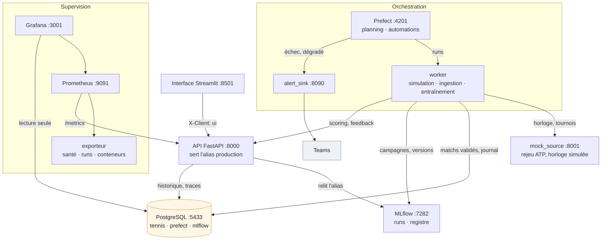

# tennis-mlops — Projet final 5MLDE

Chaîne MLOps complète qui prédit la probabilité de victoire d'un joueur dans un match ATP. Les matchs historiques
sont rejoués dans le temps par une API simulée, ce qui permet de démontrer l'ingestion continue, les contrôles
qualité, le réentraînement, la mise en service et la supervision. Le modèle est volontairement simple (régression
logistique sur des features Elo, forme, face-à-face) : ce qui compte est la chaîne, opérationnelle, reproductible et
maintenable ; ses métriques servent à suivre et à décider des mises en service.

| Livrable | Où |
|---|---|
| **Synthèse OPS** : décisions techniques, preuves d'intégration, tests de charge, dimensionnement recommandé, limites connues | [`docs/SYNTHESE_OPS.md`](docs/SYNTHESE_OPS.md) |
| Architecture | ci-dessous, et [`docs/architecture.md`](docs/architecture.md) |
| Données : provenance, licence, récupération, rejeu par lots | [Données](#données), [`docs/DONNEES.md`](docs/DONNEES.md) |
| Reproduire : installation et commandes | [Lancer le projet, de zéro](#lancer-le-projet-de-zéro) |
| Démonstration : fonctionnement nominal et incidents contrôlés, vérifiés automatiquement (S1 → S9) | [`docs/ACCEPTATION.md`](docs/ACCEPTATION.md), déroulé de la soutenance : [`docs/DEMO.md`](docs/DEMO.md) |

## Architecture



Une source simulée rejoue les matchs ATP 2010 → 2026 dans le temps ; Prefect enchaîne ingestion contrôlée par Great
Expectations, entraînement déclenché par événement et mise en service gardée par une règle ; l'API sert la version
`production` du registre MLflow ; les vrais résultats reviennent juger chaque prédiction ; Prometheus et Grafana
surveillent le tout. Flux des données, déroulé d'un pas et artefacts : [`docs/architecture.md`](docs/architecture.md).

## Lancer le projet, de zéro

Un fil à suivre dans l'ordre, sur un poste qui n'a encore rien : **les mêmes commandes sous macOS, Linux et Windows**
(dans PowerShell, sans WSL ni `make`). Compter une demi-heure en tout, dont l'essentiel à attendre.

### 1. Installer trois outils (une seule fois)

| Outil | Pourquoi | macOS / Linux | Windows |
|---|---|---|---|
| **Docker Desktop** | toute la stack tourne dans des conteneurs | [docker.com](https://www.docker.com/products/docker-desktop/) | [docker.com](https://www.docker.com/products/docker-desktop/) (il installe WSL2 lui-même) |
| **uv** | installe Python 3.12 et les dépendances verrouillées | `curl -LsSf https://astral.sh/uv/install.sh \| sh` | `powershell -c "irm https://astral.sh/uv/install.ps1 \| iex"` |
| **git** | récupérer le code | macOS : `xcode-select --install` · Linux : `sudo apt install git` | [git-scm.com](https://git-scm.com/download/win) |

Docker Desktop doit avoir **8 Go de mémoire** (macOS : Réglages → Resources ; Windows : la moitié de la RAM du PC par
défaut, donc 16 Go de RAM suffisent). Ouvrir un **nouveau** terminal après les installations, Docker Desktop lancé, et
vérifier :

```sh
docker info --format "{{.ServerVersion}}"
uv --version
git --version
```

### 2. Récupérer le code

```sh
git clone https://github.com/lulu38m/5MLDE-projet-tennis.git
cd 5MLDE-projet-tennis
```

Aucune configuration à faire : `.env` est créé depuis `.env.example` au premier lancement, aucun secret n'est
nécessaire (sans webhook Teams, les alertes restent dans l'historique de `make alerts`).

### 3. Démarrer la stack

```sh
uv run tennis up
```

5 à 10 minutes la première fois : téléchargement des données (~45 Mo, vérifiées par SHA-256), construction de l'image,
démarrage des services, puis **la chaîne entraîne elle-même un premier modèle** (ingestion 2010 → 2015 contrôlée par
Great Expectations, entraînement déclenché par événement sur le worker Prefect, règle de mise en service). La
commande se termine par :

```
modèle en production : v1 (log loss test 0.57146, données jusqu'au 2015-11-29), servi par l'API
```

### 4. Regarder

```sh
uv run tennis urls   # chaque interface, ses identifiants de démo, ● si elle répond
```

| Interface | Adresse | Ce qu'on y voit |
|---|---|---|
| Interface de test | http://127.0.0.1:8501 | prédire un match, fiches joueurs, face-à-face, matchs à venir |
| Prefect | http://127.0.0.1:4201 | les flows (ingestion, entraînement, simulation) et leurs tasks |
| MLflow | http://127.0.0.1:7282 | les campagnes, leurs candidats, le registre `atp-winner` et ses alias |
| Grafana | http://127.0.0.1:3001 | dashboards technique, métier et croisé (lecture sans compte) |
| API | http://127.0.0.1:8000/docs | `POST /predict`, `GET /model`… |

### 5. Vérifier toute la chaîne : les tests d'acceptation

```sh
uv run tennis scenarios   # S1 → S9, environ 10 minutes, une ligne ✅ par vérification
uv run tennis report      # le rapport HTML : chaque scénario, chaque vérification, les liens Prefect et MLflow
```

Ils partent de l'état laissé par `up` (une seule version, horloge au 1er janvier 2016) : les lancer **avant** `demo`.
Ce que vérifie chaque scénario : [`docs/ACCEPTATION.md`](docs/ACCEPTATION.md).

### 6. Laisser la chaîne tourner seule

```sh
uv run tennis demo        # une semaine simulée par minute : ingestion, scoring, feedback, réentraînement, alertes
uv run tennis demo-stop   # pause (le pas en cours va au bout)
```

Suivre dans Prefect (les pas de `simulation-atp`), MLflow (les nouvelles versions) et Grafana (le dashboard métier).

### 7. Arrêter, ou repartir de zéro

```sh
uv run tennis down    # arrête la stack, garde les données (up la relance telle quelle)
uv run tennis reset   # efface tout (bases, MLflow, Grafana, état local) sauf les données téléchargées
```

Après `reset`, `up` puis `scenarios` rejouent exactement le même parcours.

Sous macOS et Linux, `make up`, `make urls`, `make scenarios`, `make scenarios-report`, `make demo`, `make demo-stop`,
`make down` et `make reset` font la même chose ; le Makefile donne aussi accès à toutes les autres commandes du projet
(`make help`).

### En cas de souci

| Symptôme | Cause probable | Que faire |
|---|---|---|
| « Docker ne répond pas » | Docker Desktop fermé | l'ouvrir, attendre « Engine running », relancer `uv run tennis up` |
| `uv` ou `git` introuvable | terminal ouvert avant l'installation | ouvrir un nouveau terminal |
| `port is already allocated` | un autre programme sur un des ports (8000, 8001, 8090, 8501, 3001, 4201, 5433, 7282, 9091) | l'arrêter, ou changer le port dans `.env` |
| un service `unhealthy`, conteneur relancé en boucle | mémoire de Docker trop juste | 8 Go dans Docker Desktop, puis `uv run tennis down` et `up` |
| `scenarios` refuse : « pas dans l'état laissé par make up » | la stack a déjà servi (démo, entraînements) | `uv run tennis reset`, `up`, puis `scenarios` |
| un scénario ❌ | voir le rapport (`uv run tennis report`) et le run Prefect lié | `docker compose logs <service>` |

## Développer

```sh
make setup      # uv sync --locked + hooks pre-commit
make check      # lint + typage + tests, comme la CI
make data       # télécharge les données à la version verrouillée (~45 Mo, sans compte ni token)
make up         # stack Docker : mock_source, PostgreSQL, Prefect, MLflow, API, interface, worker, Prometheus, Grafana… et le 1er modèle
make ingest     # un passage d'ingestion contrôlé par Great Expectations, suivi dans Prefect
make train      # campagne d'entraînement en parallèle, tracée dans MLflow, meilleur modèle enregistré
make demo       # la chaîne tourne seule : temps simulé, ingestion, réentraînement sur événement, alertes Teams
make predict    # une prédiction de l'API (Djokovic contre Nadal sur terre battue)
make ui-open    # l'interface de test : deux joueurs, une surface → leur probabilité, sans terminal
```

## Commandes

| Commande | Rôle |
|---|---|
| `make setup` | Installe l'environnement et les hooks Git |
| `make lint` | ruff (lint + format) en lecture seule |
| `make format` | Corrige automatiquement le style |
| `make typecheck` | mypy en mode strict |
| `make test` | Tests unitaires + couverture |
| `make check` | Tout ce que la CI vérifie |
| `make data` | Télécharge les données brutes à la version verrouillée et vérifie les SHA-256 |
| `make data-verify` | Revérifie les fichiers locaux contre `configs/data.lock.json` |
| `make data-profile` | Profile les données → `data/raw/profile.json` |
| `make data-lock` | (Mainteneurs) Résout les révisions actuelles des sources et régénère le verrou |
| `make up` / `make down` | Démarre la stack (`--build --wait`) et garantit un modèle servi / l'arrête (volumes conservés) |
| `make reset` | Remise à zéro : volumes supprimés, état local effacé (garde `data/raw`) ; `make up` repart de l'état de référence |
| `make logs` / `make ps` | Logs et état des services |
| `make mock` | Lance `mock_source` en local, sans Docker |
| `make clock [DATE=2019-06-01]` | Lit ou règle l'horloge simulée |
| `make advance DAYS=7` | Fait avancer le temps simulé |
| `make chaos MODE=503 FAILURES=2` | Incident contrôlé (`off`, `503`, `slow`, `corrupt`, `schema`) |
| `make urls` | Adresses des interfaces, identifiants de démo, et si chacune répond |
| `make ingest` | Un passage d'ingestion : mock_source → Great Expectations → PostgreSQL |
| `make lots` | Derniers lots ingérés : statut, volumes, contrôles en échec |
| `make gx-docs` | Rapports HTML de Great Expectations |
| `make db` | Console SQL sur la base du projet |
| `make train [WORKERS=8]` | Campagne d'entraînement : grille de candidats en parallèle, MLflow, registre, décision de mise en service |
| `make train-seq` | La même campagne, un candidat à la fois (référence pour mesurer le gain du parallélisme) |
| `make train-weak` | Campagne volontairement mauvaise : enregistrée puis refusée par la règle de mise en service |
| `make mlflow` | Ouvre l'interface MLflow |
| `make registry` | Versions du modèle, alias (`production`, `previous`, `staging`), décisions |
| `make promote VERSION=3 REASON="…"` | Mise en production manuelle, raison obligatoire |
| `make rollback REASON="…"` | Revient à la version `previous` |
| `make trace [VERSION=3]` | Chaîne de traçabilité d'une version : run MLflow → run Prefect → lots → source |
| `make demo` / `make demo-stop` | Lance / met en pause la simulation planifiée (un pas de 7 jours chaque minute) |
| `make demo-status` | Déploiements Prefect, worker, derniers runs |
| `make simulate DAYS=14` | Un seul pas de simulation, sans planning |
| `make alerts` | Dernières alertes : envoyée, filtrée, répétée, sans webhook, en échec |
| `make alert-preview` / `make alert-test` | Cartes Teams d'exemple en JSON / UNE carte « 🧪 TEST » au webhook |
| `make predict P1=… P2=… SURFACE=…` | Une prédiction de l'API (par défaut Djokovic contre Nadal sur terre) |
| `make api-status` | API prête ou dégradée, version servie, historique, qualité en ligne |
| `make predictions` | Dernières prédictions : version, durée de la requête, vrai résultat |
| `make score` / `make feedback` | Prédire les matchs de la semaine / remonter les vrais résultats (faits aussi par `make demo`) |
| `make ui-open` / `make ui` | Ouvre l'interface de test (http://127.0.0.1:8501) / la lance hors Docker |
| `make ui-smoke` | Test de fumée sur la stack : la page Match prédit et la prédiction est tracée avec le client `ui` |
| `make grafana` / `make prometheus` | Ouvre les dashboards (http://127.0.0.1:3001, sans compte) / les cibles de Prometheus |
| `make grafana-check` | Vérifie les cibles Prometheus, les sources Grafana et chaque requête de chaque dashboard |
| `make dashboards` | Régénère les JSON des dashboards depuis leur code (`monitoring/dashboards.py`) |
| `make load` / `make load-full` | Campagne de charge courte (~6 min) / complète (~75 min, configs A, B, C) : rapport, CSV, graphiques |
| `make load-ui` | Locust avec son interface web (http://127.0.0.1:8089) |
| `make scenarios [ONLY=S2,S5] [SILENCE=1]` | Tests d'acceptation S1 → S9 sur la stack, cartes Teams comprises (`SILENCE=1` : aucune), rapport HTML (`make scenarios-report`) |

## Organisation du code

| Dossier | Contenu |
|---|---|
| `src/tennis_mlops/` | Chaîne MLOps (package installable, typé) |
| `src/tennis_mlops/ingestion/` | Client HTTP de la source, lots, stockage PostgreSQL, archive brute |
| `src/tennis_mlops/validation/` | Suites Great Expectations et expectations custom |
| `src/tennis_mlops/features/` | `FeatureBuilder` : features calculées avant chaque match, partagées entraînement / API |
| `src/tennis_mlops/training/` | Jeu de données, découpage temporel, pipelines, évaluation, suivi MLflow |
| `src/tennis_mlops/registry/` | Registre : tags, règle de mise en service, promotion, rollback, journal, rechargement par alias |
| `src/tennis_mlops/flows/` | Flows Prefect (`ingest.py`, `train.py`, `simulation.py`) |
| `src/tennis_mlops/orchestration/` | Déploiements, automations, déclenchement par événement, journal `pipeline_events` |
| `src/tennis_mlops/alerts/` | Cartes Teams (Adaptive Cards) et service d'alertes `alert_sink` |
| `src/tennis_mlops/serving/`, `src/tennis_mlops/api/` | Service de prédiction (historique rejoué, modèle servi, traces) et son API FastAPI |
| `src/tennis_mlops/ui/` | Interface web de test (Streamlit) : ne parle qu'à l'API |
| `src/tennis_mlops/monitoring/` | Exporteur Prometheus de la chaîne, dashboards Grafana en code, `make grafana-check` |
| `infra/` | Configuration de Prometheus et provisioning de Grafana (sources, dashboards générés) |
| `loadtest/` | Tests de charge : scénarios Locust, campagne automatisée, configurations A/B/C, résultats |
| `src/tennis_mlops/acceptance/` | Parcours correcteur : premier modèle au `make up`, tests d'acceptation `make scenarios` |
| `src/tennis_mlops/cli.py` | `uv run tennis …` : le parcours correcteur sans `make`, identique sous macOS, Linux et Windows |
| `src/mock_source/` | Simulateur de source : API FastAPI de rejeu ATP avec horloge simulée et chaos |
| `configs/` | Configuration de l'expérience (YAML, versionnée) |
| `tests/` | Tests unitaires (`unit/`) puis d'intégration (`integration/`, marqueur `integration`) |
| `docs/` | `DONNEES.md` (provenance, licence), `MOCK_SOURCE.md` (rejeu), `INGESTION.md` (contrôles), `ENTRAINEMENT.md`, `TAGGING.md` (registre, mise en service, rollback), `ORCHESTRATION.md`, `ALERTES.md`, `API.md`, `UI.md`, `MONITORING.md`, `CHARGE.md`, `SYNTHESE_OPS.md` (décisions, preuves, dimensionnement, limites), `ACCEPTATION.md` (parcours correcteur, S1 → S9), `architecture.md` (flux et artefacts), `DEMO.md` (déroulé de la soutenance) |
| `Dockerfile`, `compose.yml` | Image unique du projet et stack locale (ports publiés sur 127.0.0.1 uniquement) |
| `.env.example` | Variables d'environnement (URLs, secrets) — copier en `.env`, jamais commité |

La configuration est séparée en deux : `configs/*.yaml` décrit l'expérience (tracée dans MLflow, clés inconnues
refusées), les variables `TENNIS_*` / `MOCK_*` décrivent l'environnement (un seul `.env` partagé par les services).

## Qualité de code

- **ruff** : lint (pycodestyle, pyflakes, bugbear, nommage, annotations, docstrings…) et formatage
- **mypy --strict** avec le plugin pydantic
- **pre-commit** : ruff, mypy, fichiers > 500 Ko et clés privées bloqués à chaque commit
- **CI GitHub Actions** : `make lint typecheck test` sur chaque push et PR
- Skill Claude Code `.claude/skills/lint` : même procédure, réutilisable

## Workflow Git

- `main` reste toujours vert ; chaque phase se développe sur une branche `feat/<phase>` puis passe par une PR.
- Messages de commit au format [Conventional Commits](https://www.conventionalcommits.org/fr/) (`feat:`, `fix:`,
  `chore:`, `docs:`, `test:`).
- Un tag annoté `v0.<n>.0` à la fin de chaque phase, `v1.0.0` pour le rendu.

## Données

Matchs, classements et joueurs ATP 2010 → mai 2026 de Jeff Sackmann
([tennis_atp](https://github.com/JeffSackmann/tennis_atp)), récupérés depuis Hugging Face
([`Aneeshers/tennis-sackmann-archive`](https://huggingface.co/datasets/Aneeshers/tennis-sackmann-archive)) avec le
miroir GitHub du même dataset en secours. Licence **CC BY-NC-SA 4.0** (non commercial) : aucun fichier de données
n'est versionné : `uv run tennis up` les télécharge (seul : `make data`, ou
`uv run python -m tennis_mlops.data download`) et vérifie chaque fichier contre le verrou.

- **Reproductible** : `configs/data.lock.json` fige la révision de chaque source et le SHA-256 de chaque fichier ;
  la `dataset_version` qui en découle identifie exactement les données utilisées.
- **Résilient** : source principale injoignable → bascule sur le miroir ; contenu inattendu → arrêt, sans fallback.
- **Simulation** : le dataset historique est rejoué par lots (1 lot = 1 tournoi) pour simuler l'arrivée de
  nouvelles données.

Détails, profil et décisions : [`docs/DONNEES.md`](docs/DONNEES.md).

## Simulateur de source (`mock_source`)

API FastAPI qui rejoue l'historique selon une **horloge simulée** : `make advance DAYS=7` fait passer une semaine,
de nouveaux résultats deviennent disponibles. Aucune réponse ne peut révéler le futur (testé jour par jour) :
pas de résultat ni de classement postérieur à l'horloge, et un match à venir n'est annoncé qu'une fois ses deux
joueurs qualifiés. Les incidents (`503`, `slow`, `corrupt`, `schema`) servent à démontrer retries, alertes et
contrôles qualité bloquants.

Endpoints, règles du rejeu et incidents : [`docs/MOCK_SOURCE.md`](docs/MOCK_SOURCE.md).

## Ingestion et contrôles qualité

Le flow Prefect `ingestion-atp` tire les tournois terminés depuis `mock_source` (une task par appel HTTP, retries avec
backoff), contrôle chaque lot avec Great Expectations puis stocke dans PostgreSQL ce qui passe, en une transaction.

- **Bloquant** : schéma, domaines de valeurs et 4 expectations custom (score lisible, vainqueur ≠ perdant, aucun
  match dans le futur, volume = tableau).
- **Surveillance** (non bloquant) : dérive de l'écart de classement, comparée aux tournois du même niveau.
- **Lot refusé** : quarantaine (`state/quarantine/`), flow `Failed`, rien n'est stocké pour ce lot, reprise au
  passage suivant. Tant qu'un lot reste en quarantaine, **l'entraînement est interrompu** (flow `Failed`, alerte).
- **Source en panne** : retries, puis état « Dégradé » sans perte ; les données déjà ingérées restent utilisables.

Déroulé, contrôles, incidents et démo : [`docs/INGESTION.md`](docs/INGESTION.md).

## Entraînement

Le flow Prefect `entrainement-atp` rejoue l'historique validé pour calculer les features de chaque match **avec
l'état de la veille** (classement, Elo global et par surface, forme, face-à-face…), découpe le temps en
entraînement / validation / test, puis entraîne une grille de candidats **en parallèle** (une task Prefect par
méthode : `DatasetBuilder.build` → `TemporalSplitter.split` → `PipelineFactory.create` → `Trainer.fit` →
`Evaluator.evaluate` → `Reporter.log` → `ModelRegistry.register` → règle de mise en service → `Promoter.apply`).

- **MLflow** : un run parent par campagne (données, config, baselines, comparaison), un run enfant par candidat
  (métriques globales et par segment, coûts, graphiques, fiche modèle, pipeline complet rechargeable).
- **Lecture rapide** : chaque run a son rapport HTML dans l'onglet « Artifacts » (`rapport.html`,
  `rapport_campagne.html`) ; l'onglet « Model metrics » range les métriques par section et trace la performance
  mois par mois et les courbes d'apprentissage.
- **Choix** sur la validation, **bilan** sur le test, comparé aux baselines Elo et classement.
- **Registre** : le candidat retenu devient une nouvelle version de `atp-winner`.

Features, protocole, traçabilité et mesures : [`docs/ENTRAINEMENT.md`](docs/ENTRAINEMENT.md).

## Registre et mise en service

Le candidat retenu et le modèle en production sont jugés sur le même test récent. L'alias **`production`** (lu par
l'API : `models:/atp-winner@production`) n'est déplacé que si toutes les règles de `configs/promotion.yaml`
passent : données validées, Elo pur et « mieux classé » battus, au moins aussi bon que la production, aucune surface
dégradée, pas de dérive forte. Sinon la version est refusée (`lifecycle=rejected`, raison en tag) et gardée en
observation (`staging`).

- **Rollback** en une commande, qui ne dépend que de MLflow : `make rollback REASON="…"` (`production` ←
  `previous`) ; l'API suivra l'alias sans redéploiement.
- **Chaque décision est tracée** : tags de la version, section « Décision de mise en service » du rapport de
  campagne, et un run par décision dans l'expérience `atp-winner-decisions`.
- **Traçabilité** : `make trace` remonte de la version au run MLflow, au run Prefect, aux lots validés et à la source.

Alias, tags, règle, cycle de vie, démo : [`docs/TAGGING.md`](docs/TAGGING.md).

## API de prédiction

Le service `api` (`http://127.0.0.1:8000/docs`) sert la version désignée par l'alias `production` : pour un match à
venir, la probabilité de victoire de chaque joueur, la version et un `request_id`. Les features sont calculées par le
**même** `FeatureBuilder` que l'entraînement, sur l'historique validé rejoué jusqu'à la veille : aucun match passé ne
peut être prédit avec son propre résultat.

- **Sans redémarrage** : l'alias est relu toutes les 30 s ; une promotion ou un rollback est servi tout seul.
- **MLflow arrêté** : la version en cache continue de servir, `/ready` passe en `degraded` (scénario S8).
- **Tout est tracé** dans PostgreSQL : requêtes, prédictions (version, features), erreurs (`422` détaillés), vrais
  résultats. `prediction_outcomes` donne, pour une prédiction, sa version, sa durée et son résultat réel ;
  `online_metrics` l'accuracy, la log loss et le Brier en ligne par version.
- **Boucle complète** : chaque pas de `make demo` remonte les résultats validés (`POST /feedback`) puis prédit les
  matchs de la semaine à venir (`POST /predict/batch`).

Détails : [`docs/API.md`](docs/API.md).

## Interface web de test

Le service `ui` (`http://127.0.0.1:8501`, `make ui-open`) permet d'essayer le modèle sans terminal. Il ne parle qu'à
l'API, en se présentant avec `X-Client: ui` : ses prédictions sont tracées comme les autres.

- **Match** : deux joueurs (recherche par nom ou identifiant), une surface, un tournoi → la probabilité de chacun, la
  version, la latence, le `request_id`, et côte à côte ce que voit le modèle (classement, Elo surface, forme,
  face-à-face).
- **Joueur** et **Face-à-face** : classement dans le temps, bilans par surface et par niveau, forme, rencontres.
- **Matchs à venir** : ce que le scoring a prédit à l'avance, puis le vrai résultat et si le modèle avait raison.
- **Modèle** : version en production, qualité en ligne, horloge simulée, liens vers MLflow, Prefect et Grafana.

Tout vient de l'historique **validé** : rien après l'horloge simulée. Les erreurs sont dites simplement (API
arrêtée, aucun modèle, joueur inconnu, débutant). Détails : [`docs/UI.md`](docs/UI.md).

## Orchestration et alertes

`make demo` lance une simulation planifiée dans Prefect : chaque minute, le temps avance d'une semaine et
l'ingestion récupère les tournois terminés. Au-delà de 200 nouveaux matchs validés, l'ingestion émet l'événement
`tennis.training.requested` et une **automation** lance une campagne d'entraînement, soumise à la même règle de mise
en service. Tout tourne dans le worker de la stack ; déploiements et automations sont créés à chaque `make up`.

- **Une alerte par incident**, en carte Teams : flow en échec après ses retries, lot refusé par Great Expectations,
  source injoignable, rollback. Un incident qui persiste n'est pas renvoyé à chaque pas.
- **Webhook secret** : `TENNIS_TEAMS_WEBHOOK_URL` dans `.env` uniquement ; sans lui, les cartes sont gardées dans
  l'historique (`make alerts`) sans être envoyées.
- **Chronologie** : chaque fait marquant (lot validé ou refusé, demande d'entraînement, décision, alerte) est inscrit
  dans la table `pipeline_events`, pour les annotations Grafana.

Détails : [`docs/ORCHESTRATION.md`](docs/ORCHESTRATION.md) et [`docs/ALERTES.md`](docs/ALERTES.md).

## Monitoring

Prometheus et Grafana font partie de la stack (`make grafana`, http://127.0.0.1:3001, lecture sans compte). Trois
dashboards, provisionnés depuis le dépôt et écrits en Python :

- **Technique** (temps réel) : trafic, latences p50/p95/p99, erreurs, CPU et mémoire par conteneur (API Docker), runs
  et relances Prefect, version servie, disponibilité de chaque service.
- **Métier** (temps **simulé** : l'axe est la date des matchs) : accuracy, log loss et Brier des prédictions faites
  avant le match, calibration, favoris battus, couverture du feedback, dérive des entrées (PSI).
- **Croisé** : qualité et latence par version, effet d'un incident (matchs joués sans prédiction préalable), accuracy
  selon l'âge du modèle, coût CPU d'une bonne prédiction, latence selon la taille du batch.

Les incidents et décisions de `pipeline_events` y sont posés en annotations (rouge, orange, vert, bleu). Un
exporteur ajoute ce que l'API ne mesure pas : CPU et mémoire de chaque conteneur (API Docker), santé des services,
horloge simulée, mode d'incident de la source, runs Prefect. `make grafana-check` fait exécuter chaque requête par
Grafana. Détails : [`docs/MONITORING.md`](docs/MONITORING.md).

## Tests de charge

Locust contre l'API, sur la même machine que la stack (MacBook Pro M5 16 Go, 10 CPU et 7,7 Go pour Docker). Une
campagne automatisée (`make load-full`) compare trois configurations de l'API (A : 0,5 CPU, 1 worker ; B : 1 CPU,
2 workers ; C : 2 × B derrière nginx) sur une rampe de 10 à 1 000 utilisateurs, puis mesure un pic soudain (×5 en
10 s) et 15 min d'endurance. Un palier est tenu si le p95 reste sous 200 ms et les erreurs sous 1 %.

Résultat : **B tient 50 utilisateurs simultanés (49 req/s, p95 51 ms), C en tient 100 (98 req/s, p95 47 ms)**, A
seulement 10 ; le CPU de l'API est le goulot, un réplica de plus double la capacité, pas de fuite mémoire en 15 min,
retour à la normale 60 s après un pic ×5. Recommandation : C par défaut, +1 réplica par tranche de 50 utilisateurs,
4 au plus sur notre Mac. Protocole : [`docs/CHARGE.md`](docs/CHARGE.md) ; chiffres et graphiques :
[`docs/SYNTHESE_OPS.md`](docs/SYNTHESE_OPS.md).
