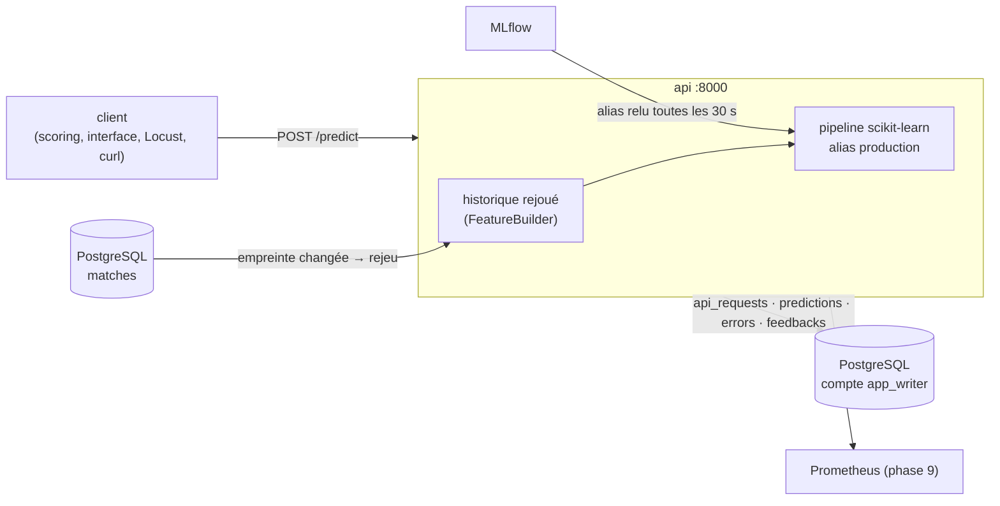

# API de prédiction

L'API sert la version de `atp-winner` désignée par l'alias `production` : pour un match à venir, elle donne la
probabilité de victoire de chaque joueur, la version qui l'a calculée et un identifiant de requête. Chaque requête,
prédiction, erreur et vrai résultat est tracé dans PostgreSQL.

Code : `src/tennis_mlops/serving/` (le service, sans HTTP) et `src/tennis_mlops/api/` (FastAPI, métriques, client).
Service `api` de la stack, sur `http://127.0.0.1:8000` (documentation interactive : `/docs`).



## Les endpoints

| Endpoint | Rôle |
|---|---|
| `POST /predict` | un match → probabilité de chaque joueur, version, `request_id` |
| `POST /predict/batch` | jusqu'à `api.max_batch` (200) matchs en un appel ; tous refusés si l'un ne peut pas l'être (son index est donné) |
| `POST /feedback` | le vrai résultat d'un match → chaque prédiction de ce match est jugée |
| `GET /model` | version servie et ses tags, état du registre, historique, qualité en ligne, limites |
| `GET /health` | le processus répond (sonde de vie) |
| `GET /ready` | `ready` ou `degraded` (200 : on sert) ; `not_ready` (503 : pas de modèle ou pas d'historique) |
| `POST /admin/reload` | relire tout de suite l'alias et l'historique (jeton `X-Admin-Token` si `TENNIS_ADMIN_TOKEN` est défini) |
| `GET /metrics` | métriques Prometheus |

```sh
make predict P1=104925 P2=104745 SURFACE=Clay     # Djokovic contre Nadal, demi-finale de Masters sur terre
```

```json
{
  "player1": {"id": 104925, "name": "Novak Djokovic", "win_probability": 0.61, "rank": 1.0, "known": true},
  "player2": {"id": 104745, "name": "Rafael Nadal", "win_probability": 0.39, "rank": 5.0, "known": true},
  "predicted_winner_id": 104925,
  "model": {"name": "atp-winner", "version": "3", "run_id": "…", "alias": "production"},
  "match_date": "2016-01-02", "features_as_of": "2015-12-31",
  "features": {"elo_diff": 112.4, "surface_elo_diff": -40.2, "h2h_diff": 3.0, "…": "…"},
  "warnings": [], "request_id": "4f1c…", "latency_ms": 12.8
}
```

(chiffres d'illustration : ils dépendent de la version servie et du jour simulé)

### Ce qu'on envoie

Un match : `player1` et `player2` (au moins leur `id` Sackmann), et si possible la surface, le niveau du tournoi
(`G`, `M`, `A`, `F`, `D`, `O`), le tour (`R128` … `F`, `RR`) et le format (`best_of` 3 ou 5). Le reste est déduit :

- **le profil du joueur** (dernier classement, points, âge vieilli jusqu'au jour du match, taille, main) vient de
  son match le plus récent en base ; une valeur envoyée le remplace (le scoring envoie le classement publié pour le
  tournoi) ;
- **la date** vaut par défaut le lendemain du dernier match connu ;
- **un joueur sans aucun match** est accepté (Elo de départ), avec un avertissement dans `warnings`.

Les valeurs autorisées sont celles des données : une faute de frappe (`"surface": "Terre"`) donne un `422`
explicite plutôt qu'une catégorie inconnue que le modèle ignorerait sans rien dire.

### Aucune fuite du futur

L'API rejoue l'historique validé avec le **même** `FeatureBuilder` que l'entraînement : les features d'un match sont
calculées avec l'état des joueurs de la veille, comme pendant l'entraînement. Un match dont la date n'est pas
postérieure à la dernière journée de l'historique est refusé (`422 invalid_match`) : son résultat entrerait dans ses
propres features. Le rejeu complet prend quelques secondes ; il est relancé dès que l'empreinte de la table
`matches` change (nouveau lot), et l'instantané précédent sert pendant ce temps. Un rejeu incrémental est
impossible : un lot arrive à la fin de son tournoi, avec des matchs plus anciens que ceux d'un tournoi déjà intégré.

Limite assumée : pendant un tournoi, ses premiers tours ne sont pas encore en base (le lot arrive à la fin) ; les
features d'un quart de finale ignorent donc les tours précédents du même tournoi. C'est un manque d'information,
pas une fuite.

## Le modèle servi

Un thread relit l'alias `production` toutes les 30 s (`api.model_refresh_s`) et ne recharge le modèle que si la
version a changé : une promotion ou un `make rollback` est servi sans redémarrage. `POST /admin/reload` le fait tout
de suite.

| Situation | `/ready` | Prédictions |
|---|---|---|
| Modèle chargé, registre et base joignables | `ready` | servies |
| MLflow arrêté après le chargement (scénario S8) | `degraded`, raison donnée | servies par la version en cache |
| Base arrêtée après le premier rejeu | `degraded` | servies avec l'historique déjà rejoué |
| Aucune version en production, ou historique jamais chargé | `not_ready` (503) | `503` explicite |
| Version entraînée avec d'autres features (`features_version`) | `not_ready` | `503` : « réentraîner » |

Chaque réponse de prédiction porte l'en-tête `X-Model-Version`, et chaque réponse l'en-tête `X-Request-ID` (repris
de la requête s'il est fourni, sinon généré).

## Ce qui est tracé

| Table | Une ligne par | Contenu |
|---|---|---|
| `api_requests` | requête | chemin, code, durée, client (`X-Client`), version, nombre de prédictions |
| `predictions` | match prédit | `match_id`, joueurs, probabilité, version et `run_id`, features utilisées, avertissements |
| `errors` | réponse 4xx/5xx | type (`validation`, `invalid_match`, `unavailable`, `internal`…), message, détail (champs en erreur, pile) |
| `feedbacks` | match dont on connaît le résultat | vainqueur, date de réception (un renvoi remplace, ne double pas) |

Les traces partent par paquets, en arrière-plan : la réponse n'attend pas la base. Si la base ne suit plus, les
lignes en trop sont comptées (`tennis_api_writer_dropped`) sans bloquer l'API. Les sondes `/health` et `/metrics`
sont comptées dans Prometheus mais pas écrites en base.

« Pour une prédiction, sa version, sa durée et son résultat réel » :

```sql
SELECT prediction_id, model_version, duration_ms, actual_winner_id, correct, winner_probability
FROM prediction_outcomes WHERE match_id = '2016-580-127';

SELECT * FROM online_metrics;   -- accuracy, log loss, Brier et durée moyenne en ligne, par version
```

`make predictions` affiche les dernières lignes de `prediction_outcomes`.

**Comptes** : l'API écrit avec `app_writer`, qui ne peut que lire les tables d'ingestion ; Grafana lira avec
`grafana_reader` (lecture seule). Les deux comptes et leurs droits sont créés par `postgres-setup` à chaque `make up`.

## Scoring et feedback

Chaque pas de `make demo` enchaîne, après l'ingestion :

1. **feedback** (`feedback-atp`) : les matchs prédits dont le résultat **validé** vient d'entrer en base (table
   `matches`, jamais la source brute) sont envoyés à `POST /feedback` ; les forfaits ne jugent rien ;
2. **scoring** (`scoring-atp`) : les matchs de la semaine à venir (`GET /fixtures` de la source) sont prédits par
   `POST /predict/batch`, une seule fois chacun, avec le classement publié pour le tournoi.

Le scoring passe par l'API comme n'importe quel client : ses prédictions ont la même version, les mêmes traces et
les mêmes métriques que celles de l'interface. Sans modèle en production, il ne fait rien et le dit (ce n'est pas un
incident) ; si l'API ne répond pas, il échoue et une carte Teams part. Si la source est injoignable, il n'est pas
lancé : l'ingestion « Dégradé » a déjà son alerte. `make score` et `make feedback` les lancent à la main.

## Métriques Prometheus

| Métrique | Libellés |
|---|---|
| `tennis_api_requests_total` | méthode, chemin (gabarit de route), code |
| `tennis_api_request_duration_seconds` (histogramme) | chemin |
| `tennis_api_predictions_total` | version, client |
| `tennis_api_batch_size` (histogramme) | |
| `tennis_api_feedback_predictions_total` | version, juste ou non |
| `tennis_api_errors_total` | type d'erreur |
| `tennis_api_model_info`, `_model_stale`, `_model_reloads`, `_model_load_seconds` | version servie et état du registre |
| `tennis_api_features_last_day_timestamp`, `_features_build_seconds`, `_features_players` | historique |
| `tennis_api_writer_pending`, `_writer_dropped`, `_writer_failed` | file d'écriture |
| `tennis_api_ready` | 2 prêt, 1 dégradé, 0 pas prêt |
