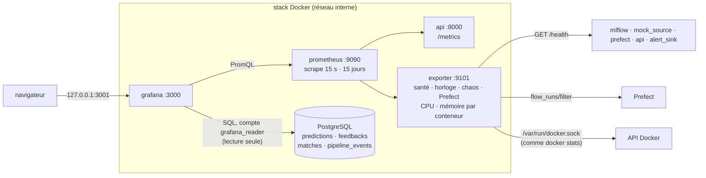

# Monitoring : Prometheus et Grafana

Trois dashboards pour lire la chaîne sans ouvrir de terminal : **Technique** (le service tient-il ?), **Métier**
(le modèle prédit-il bien ?) et **Croisé** (ce qu'un incident ou une nouvelle version coûte, en latence comme en
qualité). Les incidents et les décisions du pipeline y sont posés automatiquement en annotations.

```sh
make up              # la stack, monitoring compris
make grafana         # http://127.0.0.1:3001 : les trois dashboards, sans compte
make grafana-check   # chaque cible Prometheus, chaque source Grafana, chaque requête de chaque panneau
```



| Service | Image | Rôle | Adresse sur le Mac |
|---|---|---|---|
| `prometheus` | `prom/prometheus:v3.11.3` | collecte `api` et `exporter` toutes les 15 s ; garde 15 jours | http://127.0.0.1:9091 (`make prometheus`) |
| `grafana` | `grafana/grafana:13.2.3` | sources de données et dashboards provisionnés depuis le dépôt ; lecture anonyme | http://127.0.0.1:3001 (`make grafana`) |
| `exporter` | image du projet | ce que l'API ne mesure pas, dont le CPU et la mémoire de chaque conteneur (ci-dessous) | interne |

Ports décalés (3001, 9091) pour coexister avec la stack des TP. Le compte `admin` (mot de passe
`TENNIS_GRAFANA_ADMIN_PASSWORD` dans `.env`) sert à modifier un dashboard pour essayer : la modification ne peut pas
être enregistrée, la source de vérité est le code.

## Les dashboards sont du code

`src/tennis_mlops/monitoring/dashboards.py` décrit les trois dashboards (requêtes, seuils, unités, disposition) ;
`make dashboards` les écrit dans `infra/grafana/dashboards/*.json`, que Grafana relit toutes les 30 s. Chaque
requête passe donc en revue de code, et un test refuse un JSON qui ne correspond pas au code.

| Fichier | Contenu |
|---|---|
| `infra/prometheus/prometheus.yml` | les trois cibles : `api`, `exporter`, `prometheus` |
| `infra/grafana/provisioning/datasources/datasources.yml` | Prometheus (`uid: prometheus`), base du projet (`uid: tennis-pg`, compte `grafana_reader`) |
| `infra/grafana/provisioning/dashboards/dashboards.yml` | dossier « Tennis MLOps », fichiers en lecture seule |
| `infra/grafana/dashboards/{technique,metier,croise}.json` | générés : ne pas modifier à la main |

## Technique : le service tient-il ? (temps réel)

| Rangée | Panneaux |
|---|---|
| État | API prête / dégradée / pas prête · version servie · requêtes/s · latence p95 des prédictions · part de 5xx · horloge simulée · disponibilité de chaque service dans le temps |
| API | requêtes par endpoint · latence p50/p95/p99 par endpoint · réponses hors 2xx par code · erreurs par type · matchs prédits par client · file d'écriture des traces (en attente, perdues, refusées) |
| Conteneurs | CPU et mémoire par service, part de la limite mémoire de chacun |
| Flows et modèle | runs Prefect des dernières 24 h par flow et par état · durée du dernier run · relances · durée des chargements de l'API · registre MLflow joignable et changements de version |

## Métier : le modèle prédit-il bien ? (temps simulé)

L'axe des temps est **la date des matchs**, pas l'heure réelle : la démo rejoue des années en quelques minutes. La
période affichée par défaut couvre tout le jeu (2015 → 2026) ; zoomer sur une saison fonctionne comme d'habitude.

On ne juge que les prédictions **du scoring**, faites avant le match, sur le résultat **validé** par l'ingestion
(`feedbacks`) : jamais une prédiction faite après coup.

| Rangée | Panneaux |
|---|---|
| Qualité en ligne | accuracy · log loss · Brier · matchs jugés · couverture du feedback · part des favoris à 70 % battus, puis accuracy et log loss par semaine, Brier par semaine |
| Calibration et surprises | probabilité annoncée pour le favori contre part de victoires réelle, par tranche de 10 % · favoris battus par mois |
| Ce qu'on prédit | prédits et jugés par semaine · répartition par surface et par niveau · qualité par surface · tournois les plus prédits |
| Dérive des entrées | PSI de chaque feature (temps réel, voir plus bas) |

## Croisé : technique et métier ensemble

| Question | Panneau |
|---|---|
| Le nouveau modèle coûte-t-il plus cher ? | qualité et latence par version (vue `online_metrics`) ; accuracy et latence côte à côte |
| Que fait un incident aux prédictions ? | mode d'incident de la source dans le temps ; erreurs de l'API et services injoignables ; **matchs joués sans prédiction préalable**, lot par lot |
| Quand réentraîner ? | accuracy selon l'âge du modèle : jours simulés entre la fin de ses données d'entraînement et le match |
| Combien coûte une bonne prédiction ? | secondes de CPU de l'API par prédiction jugée juste |
| Faut-il envoyer des batchs ? | latence totale et par match selon la taille de l'appel |

L'âge du modèle vient de la nouvelle colonne `predictions.model_data_end` (tag `data_window_end` de la version qui a
prédit), ajoutée à une table existante au démarrage de l'API, sans perte.

## Annotations : le journal du pipeline sur chaque dashboard

Chaque événement de `pipeline_events` ([ORCHESTRATION.md](ORCHESTRATION.md)) devient une annotation, colorée par
gravité :

| Couleur | Gravité | Exemples |
|---|---|---|
| rouge | `failure` | lot mis en quarantaine (données corrompues, schéma changé) |
| orange | `warning` | ingestion dégradée (source injoignable) |
| vert | `success` | version mise en production, rollback |
| bleu | `info` | réentraînement demandé, candidat refusé |

Sur Technique et Croisé, l'annotation est à l'heure réelle de l'événement. Sur Métier, elle est à sa **date
simulée** : celle du lot pour une ingestion ; pour une décision (promotion, rollback), qui n'en a pas, la date de la
dernière ingestion qui la précède, c'est-à-dire où en était l'horloge. Les ingestions réussies et les alertes, un
événement par pas de simulation, restent dans le journal sans annoter les dashboards.

## L'exporteur de la chaîne

`python -m tennis_mlops.monitoring` (service `exporter`), une passe à chaque lecture de Prometheus : sondes en
parallèle (3 s au plus chacune), réponses de Prefect gardées 10 s. Il ne reçoit ni `.env` ni identifiant.

Le CPU et la mémoire des conteneurs viennent de l'**API Docker** (`monitoring/containers.py`), comme
`docker stats` : la liste des conteneurs du projet compose, puis leurs statistiques en parallèle. C'était le rôle de
cAdvisor, abandonné : depuis Docker 29 et le magasin d'images containerd (Docker Desktop récent), cAdvisor doit
joindre le socket de containerd, qui n'est pas exposé aux conteneurs sur macOS, et ne voyait plus aucun conteneur.
Le socket Docker n'étant lisible que par root, l'exporteur est le seul service lancé en root ; il n'envoie que des
`GET` (cAdvisor demandait en plus le mode `privileged` et le système de fichiers de l'hôte).

| Métrique | Contenu |
|---|---|
| `tennis_service_up{service}`, `tennis_service_probe_seconds{service}` | santé de mlflow, mock_source, prefect, api, alert_sink |
| `tennis_simulated_clock_timestamp` | date simulée de la source |
| `tennis_source_chaos{mode}` | 1 pour le mode d'incident en cours (`off`, `503`, `slow`, `corrupt`, `schema`) |
| `tennis_prefect_flow_runs{flow,state}` | runs commencés dans les dernières 24 h |
| `tennis_prefect_flow_run_seconds{flow}`, `tennis_prefect_flow_last_end_timestamp{flow}` | dernier run terminé |
| `tennis_prefect_retries{flow}` | relances de tasks et de flows |
| `tennis_exporter_prefect_up` | 0 si Prefect n'a pas répondu |
| `tennis_container_cpu_seconds_total{service,container}` | temps CPU cumulé (`rate()` donne des cœurs) |
| `tennis_container_memory_bytes{service,container}` | mémoire de travail (usage moins cache inactif, comme `docker stats`) |
| `tennis_container_memory_limit_bytes{service,container}` | limite `deploy.resources.limits.memory` |
| `tennis_docker_up` | 0 si l'API Docker n'a pas répondu |

L'API ajoute à ses métriques (phase 7) `tennis_api_feature_drift_psi{feature}` et `tennis_api_drift_sample`.

## Dérive des entrées

L'API garde les features des **500 dernières prédictions** servies (`api.drift_window`) et les compare, par le
**PSI** sur les déciles, aux **deux années** de matchs qui précèdent la fin des données d'entraînement de la version
servie (`api.drift_reference_days`, tag `data_window_end`) :

| PSI | Lecture (seuils de la dérive entre campagnes, `training/drift.py`) |
|---|---|
| < 0,1 | stable |
| 0,1 à 0,2 | à surveiller |
| > 0,2 | la distribution a changé : le modèle extrapole |

Les features sont des écarts entre joueur 1 et joueur 2, dont le signe dépend de l'ordre des joueurs (tiré au
hasard à l'entraînement, imposé par le tableau en ligne) : on compare leur **valeur absolue**, l'écart de niveau.
Le rapport est aussi dans `GET /model` (`drift`). Toutes les prédictions comptent, quel que soit le client : un test
de charge sur des paires tirées au hasard fait monter le PSI de la forme ou du repos, et c'est normal.

## Lire un incident sans terminal

Pendant une démo (`make demo`), `make chaos MODE=503` :

1. **Croisé**, « Incident en cours sur la source » : une bande rouge `503` ;
2. **Technique** : `mock_source` reste en ligne (il répond 503 exprès), les relances de `ingestion-atp` et
   `scoring-atp` montent, des runs passent en échec ;
3. annotation orange « Ingestion dégradée » sur les trois dashboards ;
4. **effet métier**, une fois `make chaos MODE=off` : les matchs que le scoring n'a pas pu lire sont ingérés **sans
   prédiction préalable** (barres rouges du Croisé), et « Prédits et jugés par semaine » montre le trou sur le
   Métier, à la date simulée de l'incident.

`MODE=corrupt` ou `MODE=schema` : annotation rouge (lot en quarantaine) et matchs manquants, sans erreur HTTP.

## Vérifier

```sh
make grafana-check
# ✅ Prometheus · cible api / exporter / prometheus
# ✅ Exporteur · conteneurs : 14 suivis (API Docker)
# ✅ Grafana · source prometheus / tennis-pg
# ✅ Tennis · Technique : 24 panneaux
# ✅ Tennis · Technique · Requêtes / s [A] : 120 point(s)
# ⚠️  Tennis · Métier · Calibration du favori [A] : aucune donnée     ← rien de jugé encore : pas une erreur
# 52 ok · 3 sans donnée · 0 erreur(s)
```

Chaque requête est exécutée par Grafana lui-même (`/api/ds/query`), sur la période de son dashboard : une erreur
SQL ou PromQL, un droit manquant du compte `grafana_reader` ou une cible tombée fait échouer la commande.

Tests (`make test`) :

- `tests/unit/monitoring/test_dashboards.py` : JSON à jour, grille sans chevauchement, chaque requête sur une source
  provisionnée, **chaque métrique PromQL existe** (API, exporteur), séries SQL avec une colonne `time`,
  Métier en temps simulé, annotations des quatre gravités ;
- `tests/unit/monitoring/test_check.py` : `make grafana-check` contre un Grafana simulé (requête cassée, cible
  tombée, dashboard pas à jour, Grafana éteint) ;
- `tests/unit/monitoring/test_exporter.py` : sondes, horloge, chaos, résumé des runs Prefect ;
- `tests/unit/monitoring/test_containers.py` : statistiques Docker (cgroup v1 et v2), conteneurs du projet seulement ;
- `tests/unit/serving/test_drift.py` : PSI, indépendance à l'ordre des joueurs, fenêtre, `GET /model` et métriques.

## Limites connues

- **Socket Docker** : l'exporteur lit `/var/run/docker.sock` (le chemin que Docker Desktop expose aux conteneurs sur
  macOS comme sous Linux). S'il ne répond pas, `make grafana-check` le dit (« Exporteur · conteneurs ») et seuls les
  panneaux CPU, mémoire et coût CPU d'une bonne prédiction restent vides.
- Le panneau de dérive est en temps réel (dernier quart d'heure) même sur le dashboard Métier, dont l'axe est simulé.
- Le mot de passe admin n'est lu qu'à la création du volume `grafana_data` (voir `.env.example`).
