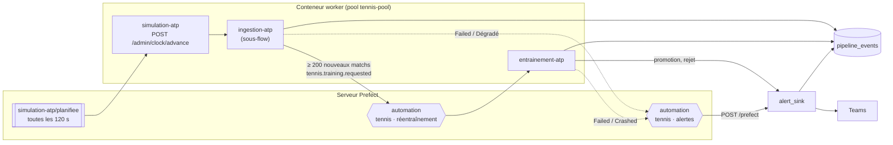

# Orchestration : la chaîne qui tourne seule

`make demo` démarre la stack puis lance une **simulation planifiée** : toutes les 2 minutes réelles, l'horloge de
`mock_source` avance d'une semaine, l'ingestion récupère les tournois qui viennent de se terminer, et dès que
200 nouveaux matchs validés se sont accumulés, un **événement** déclenche une campagne d'entraînement. Un incident
(lot refusé, source injoignable, flow en échec) produit **une** carte Teams. Personne n'intervient.

Code : `src/tennis_mlops/orchestration/` (`setup.py`, `trigger.py`, `events.py`, `decisions.py`, `clock.py`) et
`src/tennis_mlops/flows/simulation.py`. Les alertes : [`ALERTES.md`](ALERTES.md).

## Vue d'ensemble



| Objet Prefect | Rôle |
|---|---|
| work pool `tennis-pool` (type `process`) | Le worker de la stack y prend les runs et les exécute dans son conteneur, un sous-processus par run. |
| `simulation-atp/planifiee` | Toutes les `simulation_interval_s` secondes : +`simulation_days_per_run` jours, puis ingestion. **En pause** tant que `make demo` ne l'a pas lancé ; un pas en retard est sauté (`CANCEL_NEW`), jamais empilé. |
| `entrainement-atp/sur-evenement` | Une campagne à la fois (`ENQUEUE`) : lancée par l'automation, ou à la main depuis l'UI. Le nombre de candidats en parallèle vient de `configs/train.yaml`. |
| `ingestion-atp/manuelle` | Un passage d'ingestion depuis l'UI (la simulation l'appelle elle-même en sous-flow). |
| automation « tennis · réentraînement » | `tennis.training.requested` sur la ressource `tennis.dataset.atp` → lance `entrainement-atp/sur-evenement`. |
| automation « tennis · alertes » | `prefect.flow-run.Failed`, `Crashed` ou `Dégradé` d'un de nos trois flows → `POST /prefect` du service d'alertes (bloc `Webhook` `tennis-alert-sink`). |

Tout est créé par `python -m tennis_mlops.orchestration setup`, lancé **à chaque `make up`** par le service ponctuel
`orchestration-setup` : rien à cliquer dans l'UI, et une modification de `configs/project.yaml` est appliquée au
prochain `make up`. La mise en place est idempotente (pas de doublon de planning ni d'automation) et **conserve
l'état de pause** de la simulation : un `make up` en pleine démo ne l'arrête pas.

## Les commandes

| Commande | Effet |
|---|---|
| `make demo` | `make up`, puis la simulation reprend et un premier pas part tout de suite |
| `make demo-stop` | Simulation en pause (le run en cours va jusqu'au bout) ; `make demo` la relance |
| `make demo-status` | Déploiements, worker actif, dix derniers runs |
| `make simulate DAYS=14` | Un seul pas, lancé depuis la machine hôte, sans planning |
| `make alerts` | Les dernières alertes et ce qu'elles sont devenues |
| `make chaos MODE=schema` / `MODE=503 FAILURES=20` | Provoquer une quarantaine / une ingestion dégradée pendant la démo |

Réglages (`configs/project.yaml`, section `orchestration`) :

```yaml
orchestration:
  simulation_days_per_run: 7     # jours simulés par pas
  simulation_interval_s: 120     # un pas toutes les 2 minutes réelles
  training_trigger_matches: 200  # nouveaux matchs validés avant de demander un réentraînement (0 = jamais)
  teams_events: [echec, quarantaine, degrade, rollback]
  alert_cooldown_min: 30
```

## Un pas de simulation

`simulation-atp` fait deux choses : `POST /admin/clock/advance` (seule écriture du projet vers la source, sur son
API d'administration que le chaos ne touche jamais), puis le flow `ingestion-atp` **en sous-flow**.

- **Un incident = une alerte.** L'issue de l'ingestion (quarantaine, dégradé) est portée par le sous-flow, qui
  déclenche sa propre alerte ; la simulation se termine normalement et écrit l'issue dans son bilan. Si elle
  échouait aussi, chaque incident d'ingestion produirait deux cartes.
- **Horloge injoignable** : le pas est sauté mais l'ingestion tourne quand même ; c'est elle qui constate la panne
  (état « Dégradé », une alerte).
- **Fin du rejeu** (`simulation.replay_end`, mai 2026) : plus rien à avancer, le flow le dit et ne fait rien d'autre.

## Le réentraînement déclenché par un événement

L'ingestion ne lance pas l'entraînement elle-même. À la fin de chaque passage, la task « journal et déclenchement de
l'entraînement » compte les matchs stockés depuis la **dernière demande** (`pipeline_events`) ; au-delà de
`training_trigger_matches`, elle émet l'événement Prefect `tennis.training.requested` (avec le nombre de matchs, le
seuil, le run et la date simulée) et l'inscrit dans `pipeline_events`. L'automation y répond en lançant le
déploiement d'entraînement.

Pourquoi un événement plutôt qu'un appel direct : les deux flows restent indépendants (on peut entraîner à la main,
une ingestion sans automation n'entraîne rien), le déclenchement est visible dans l'onglet *Events* de Prefect, et
la règle (seuil) se change sans toucher au code de l'entraînement. Pourquoi un seuil en matchs plutôt qu'un
planning : réentraîner sans données nouvelles ne sert à rien ; 200 matchs, c'est environ deux semaines de circuit.

Une campagne lancée ainsi suit exactement la même règle de mise en service que `make train` : elle peut très bien
**refuser** son modèle (c'est une décision, pas un échec ; aucune alerte).

## Cache du jeu d'entraînement

La task `DatasetBuilder.build` est mise en cache par Prefect. Clé : empreinte des matchs en base (nombre, dernier
ajout, dernier match) + réglages des features (`configs/train.yaml`) + `FEATURES_VERSION`. Tant que rien ne change,
le jeu de features n'est pas recalculé (`make train-weak` juste après `make train`, ou une campagne relancée depuis
l'UI) : le run de campagne le dit (`data.cached = True` dans MLflow). Dès qu'un lot est ajouté, l'empreinte change
et le jeu est reconstruit. Le cache expire au bout de 7 jours.

## Le journal `pipeline_events`

Une table de la base du projet, une ligne par fait marquant, avec ses identifiants (run Prefect, lot, version) :
c'est la chronologie que liront les annotations Grafana (phase 10).

| `kind` | Écrit par | Gravité |
|---|---|---|
| `ingestion_completed` | ingestion (lots validés) | info |
| `lot_quarantined` | ingestion, task `quarantaine` (tournoi, volumes, contrôles en échec structurés) | failure |
| `ingestion_degraded` | ingestion (source injoignable après les retries) | warning |
| `training_requested` | ingestion (seuil atteint) | info |
| `model_promoted` / `model_rejected` | campagne d'entraînement (décision de la règle) | success / info |
| `manual_promotion` / `rollback` | `make promote` / `make rollback` | warning |
| `alert` | service d'alertes (carte envoyée, filtrée, répétée, en échec) | selon la carte |

Écrire un événement ne fait jamais échouer un flow : une base indisponible est signalée dans les logs.

```sql
SELECT occurred_at, kind, title FROM pipeline_events ORDER BY occurred_at DESC LIMIT 20;  -- make db
```

## Où tournent les runs

Le worker est un conteneur de la stack (même image que le reste). Il lit les adresses **internes** du réseau Docker
(`postgres:5432`, `mlflow:7282`, `mock_source:8001`, `alert_sink:8090`), fixées dans `compose.yml` : celles de
`.env` sont écrites pour la machine hôte (`127.0.0.1:5433`…). Le dossier `state/` (quarantaine, Great
Expectations) est partagé avec la machine hôte : `make lots` et `make gx-docs` voient ce que le worker a produit.
Les commandes `make ingest` et `make train` restent possibles depuis la machine hôte, en parallèle.

Le code exécuté est celui de l'image : après une modification du code ou de `configs/`, `make up` reconstruit
l'image et remet les déploiements à jour. La révision Git est gravée dans l'image au build (`GIT_COMMIT`) : les
campagnes lancées par le worker la tracent dans MLflow comme celles lancées à la main.
