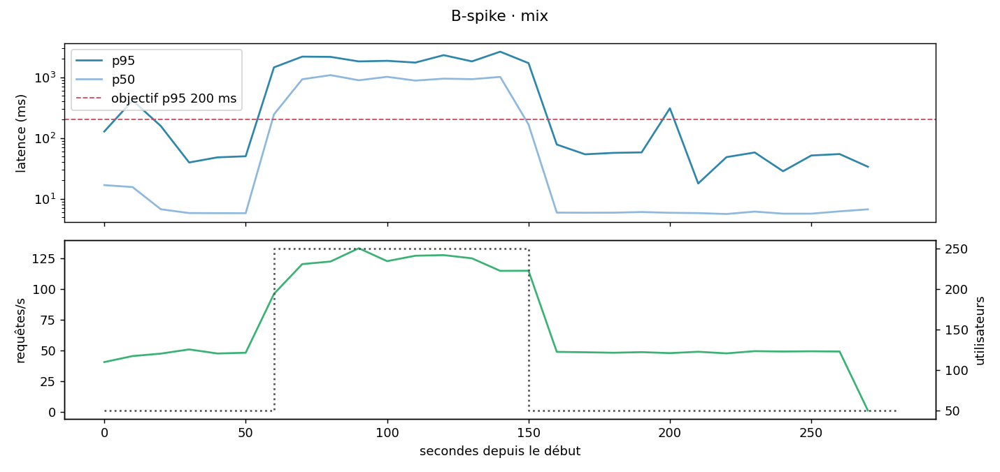

# Synthèse OPS

Les décisions d'exploitation du projet, ce qui prouve que la chaîne marche, combien d'utilisateurs elle tient, et ce
qu'elle ne fait pas. Chaque preuve se rejoue sur une machine neuve : `uv run tennis up`, puis
`uv run tennis scenarios` ([ACCEPTATION.md](ACCEPTATION.md)). L'architecture : [architecture.md](architecture.md).

## En bref

| | |
|---|---|
| **Ce qui tourne** | 13 services dans Docker (dont 2 tâches ponctuelles de mise en place), une seule image construite depuis `uv.lock`, ports sur `127.0.0.1` |
| **Ce qui est vérifié automatiquement** | 445 tests unitaires (couverture 93 %), lint et typage strict en CI ; 9 tests d'acceptation de bout en bout sur la stack (S1 → S9), verts en 7 minutes |
| **Ce que le modèle vaut** | log loss 0,600 contre 0,613 pour l'Elo pur et 0,622 pour le classement seul (test juin → novembre 2016) : il bat les baselines, de peu |
| **Ce que l'API tient** | 50 utilisateurs simultanés par réplica à 1 CPU (p95 51 ms) ; 100 avec deux réplicas derrière nginx |
| **Ce qui protège la production** | données contrôlées avant stockage (lot refusé = quarantaine), version promue seulement si elle fait au moins aussi bien que la production sur le même test, rollback en une commande, servi sans redémarrage |

## 1. Décisions techniques

| Domaine | Décision | Écarté | Pourquoi | Preuve |
|---|---|---|---|---|
| Données | Révision figée et SHA-256 de chaque fichier dans `configs/data.lock.json`, miroir GitHub en secours | DVC | Même principe que `uv.lock` pour les dépendances, sans service de plus ; un contenu différent bloque au lieu de basculer | `make data-verify` ; Hugging Face et miroir : mêmes 23 SHA-256 |
| Source | `mock_source` rejoue l'historique selon une horloge simulée, un lot par tournoi terminé | lire les CSV directement | Montrer une ingestion continue, des retards et des pannes ; aucune réponse ne révèle le futur | `test_no_future_leak` : 0 violation sur 46 964 matchs, 30 dates |
| Ingestion | Mode pull, une task Prefect par appel HTTP, retries avec backoff sur panne seulement | retenter aussi les `4xx` | Une erreur de contrat ne se corrige pas en réessayant ; une panne si | S3 (503, lenteur), S4 (source arrêtée) |
| Qualité | Great Expectations bloquant (36 contrôles, dont 4 expectations custom), quarantaine, le watermark ne dépasse jamais un lot refusé | contrôles d'après coup | Rien de faux n'entre en base ; le lot refusé est retenté au passage suivant | S2 (corrompu), S5 (schéma) |
| Features | Un seul `FeatureBuilder` pour l'entraînement et l'API, sur le même historique validé | features recalculées côté API | Pas d'écart entraînement / service ; une version entraînée avec d'autres features n'est pas servie | tests du `FeatureBuilder`, `features_version` dans les tags |
| Entraînement | Découpage temporel (entraînement, validation pour choisir, test jamais vu) ; 8 candidats en parallèle, un run MLflow chacun | découpage aléatoire | Un découpage aléatoire laisserait le futur entraîner un modèle jugé sur le passé | rapports HTML des campagnes, `make train-seq` pour comparer |
| Mise en service | Alias `production` / `previous` / `staging` et tags de décision ; règle : données validées, Elo pur et classement battus, au moins aussi bon que la production sur le même test, aucune surface nettement dégradée, dérive bornée | stages MLflow, promotion manuelle | Une promotion ou un rollback = déplacer un alias, sans redéploiement ; une décision tracée, règle par règle | S1 (promue), S6 (refusée), S7 (rollback) ; [TAGGING.md](TAGGING.md) |
| Orchestration | Prefect : simulation planifiée, entraînement **déclenché par événement** (≥ 200 nouveaux matchs validés), automations vers les alertes ; serveur Prefect dans l'image du projet | entraînement planifié | On réentraîne quand il y a de quoi apprendre, pas à heure fixe ; l'image officielle (SQLAlchemy 2.1) casse le planificateur | S1 ; `test_compose.py` |
| Alertes | Une alerte = un incident, sur l'état final après retries ; dédoublonnage, une carte par demi-heure pour un incident qui persiste, filtre par type, mode silence pendant les tests | une carte par échec de task | Le canal est partagé : il ne doit recevoir que ce qui demande une action | S2 à S5, S7 ; [ALERTES.md](ALERTES.md) |
| Service | L'API relit l'alias toutes les 30 s, garde le modèle en mémoire si MLflow tombe, écrit ses traces en arrière-plan avec un compte limité | recharger à chaque requête, redémarrer pour changer de version | Disponibilité : on sert même registre arrêté ; latence : la réponse n'attend pas la base | S7, S8 ; p95 27 ms en unitaire |
| Supervision | Prometheus et Grafana ; dashboards écrits en Python ; dashboard métier sur l'axe du temps simulé ; CPU et mémoire lus sur l'API Docker | dashboards cliqués, cAdvisor | Versionnés et testés comme le code ; cAdvisor ne voit plus les conteneurs sous Docker 29 / Docker Desktop | `make grafana-check` (chaque requête de chaque panneau) |
| Reproductibilité | `uv.lock`, une image, configs versionnées et tracées, tests d'acceptation partant d'un état de référence, rejeu à partir de 2016 | — | Le même résultat sur toutes les machines ; sur 2010 → 2014, le premier modèle ne bat pas le classement et la règle le refuse | 9/9 verts deux fois de suite sur une stack neuve |
| Portabilité | Parcours correcteur en Python (`uv run tennis …`), fins de ligne forcées en LF, worker avec l'identité de l'hôte | Makefile seul | Mêmes commandes sous macOS, Linux et Windows (PowerShell, sans WSL ni make) | `test_cli.py`, `test_compose.py` |

## 2. Preuves d'intégration

| Critère | Ce qui le prouve | Comment le rejouer |
|---|---|---|
| Qualité du code | ruff (lint, format, docstrings, annotations), mypy `--strict`, 445 tests, couverture 93 %, pre-commit, CI GitHub Actions sur chaque push | `make check` |
| Reproductibilité | données verrouillées par SHA-256, dépendances par `uv.lock`, image unique, état de référence vérifié avant les tests d'acceptation | `uv run tennis reset`, `up`, `scenarios` |
| Intégration MLOps | S1 : un pas de simulation de cinq mois ingère 64 lots, déclenche l'entraînement par événement, promeut v2 et l'API la sert sans redémarrage ; le pas suivant remonte les feedbacks | `uv run tennis scenarios --only S1` |
| Fiabilité et traçabilité | S2, S5 : lots refusés, rien de stocké, alerte ; S3, S4 : retries puis état dégradé, rien de perdu ; S6, S7 : refus et rollback tracés ; `make trace` remonte d'une version jusqu'aux SHA-256 des fichiers sources | `uv run tennis scenarios`, `make trace` |
| Exploitation du service | S8 : registre arrêté, l'API sert depuis son cache et trace le `422` ; S9 : l'interface prédit et la prédiction est tracée ; 3 dashboards, annotations automatiques | `uv run tennis scenarios --only S8,S9`, `make grafana-check` |
| Dimensionnement | campagne Locust automatisée, 3 configurations, rampe, pic, endurance | `make load-full` ; section 3 |

Le rapport HTML de chaque passe (`uv run tennis report`) montre, pour chaque scénario, chaque vérification et les
liens vers le run Prefect et la version MLflow concernés.

## 3. Dimensionnement de l'API de prédiction

### En une phrase

Sur notre Mac (M5, 16 Go, 10 CPU et 7,7 Go pour Docker), **la configuration B (1 CPU, 2 workers) tient
50 utilisateurs simultanés, soit 49 req/s, avec un p95 de 51 ms** ; deux réplicas de B derrière nginx (C) en tiennent
**100 (98 req/s, p95 de 47 ms)**. Recommandation : **C par défaut, un réplica de B de plus par tranche de 50
utilisateurs, plafond de 4 réplicas sur cette machine.**

### Protocole

Locust, campagne automatisée (`make load-full`, [CHARGE.md](CHARGE.md)) : rampe par paliers de 2 min (10 → 50 →
100 → 200 → 500 → 1 000 utilisateurs), un utilisateur envoyant environ une requête par seconde en usage mixte (60 %
de prédictions, recherches et fiches joueur, face-à-face, un batch de 50 matchs de temps en temps). Un palier est
**tenu** si le p95 des requêtes unitaires reste sous **200 ms**, celui des batchs sous **1 s**, et les erreurs sous
**1 %**. Percentiles exacts sur chaque requête, montée du palier exclue ; CPU et mémoire des conteneurs lus dans
Prometheus.

| | |
|---|---|
| Machine | MacBook Pro (Mac17,2), Apple M5, 10 cœurs, 16 Go |
| Docker | Docker Desktop, moteur 29.9.2, 10 CPU et 7,7 Go alloués |
| Résultats | [`loadtest/results/20261117-1242-full/`](../loadtest/results/20261117-1242-full/report.md) |

### Comparaison des configurations (rampe, usage mixte)

| Config | Ressources de l'API | **Max utilisateurs tenus** | Débit à ce palier | p95 | Premier palier qui lâche | CPU API au max | Mémoire API | Saturation |
|---|---|---|---|---|---|---|---|---|
| **A** | 1 réplica · 0,5 CPU · 512 Mo · 1 worker | **10** | 10 req/s | 37 ms | 50 (p95 516 ms) | 0,14 cœur | 406 Mo | ~70 req/s ; tuée à 1 000 utilisateurs |
| **B** | 1 réplica · 1 CPU · 1,5 Go · 2 workers | **50** | 49 req/s | 51 ms | 100 (p95 243 ms) | 0,39 cœur | 851 Mo | ~125 req/s (CPU à 1,0) |
| **C** | 2 × B derrière nginx | **100** | 98 req/s | 47 ms | 200 (p95 312 ms) | 0,66 cœur | 1,7 Go | ~210 req/s réussies (CPU à 2,0) |

Ce qu'on en lit :

- **Le CPU de l'API est le goulot.** À saturation, l'API utilise toute sa limite (1,0 cœur pour B, 2,0 pour C),
  pendant que PostgreSQL reste sous 0,07 cœur. Pour B, aucune erreur jusqu'à 500 utilisateurs : les requêtes
  attendent leur tour et le p95 explose (1,6 s à 200 utilisateurs, 4,4 s à 500). En C, nginx commence à
  répondre 502 à partir de 500 utilisateurs (2,9 %).
- **Ajouter un réplica double la capacité** : 50 → 100 utilisateurs tenus de B à C, saturation de 125 à ~210 req/s
  réussies (×1,7 : nginx et la base partagée prennent le reste). La montée en charge est horizontale.
- **A est à proscrire** : 0,5 CPU ne tient que 10 utilisateurs, et 512 Mo ne suffisent pas. Un worker prend déjà
  406 Mo sous faible charge (le modèle et l'historique rejoué) ; sous 1 000 utilisateurs, l'API atteint 536 Mo pour une
  limite de 512 Mio et tombe (connexions refusées, puis 503 pendant le rechargement : 94 % d'erreurs).
- **Mémoire : ~420 Mo par worker**, qui grossit peu sous charge (+125 Mo pour B entre 10 et 500 utilisateurs,
  requêtes en attente comprises).

### Prédiction seule et batch (config B)

| Scénario | Max tenu | Débit | p95 | Coût CPU |
|---|---|---|---|---|
| `POST /predict` seul | 100 utilisateurs | 98 req/s | 43 ms | ~5 ms de CPU par prédiction (0,50 cœur à 98 req/s) |
| `POST /predict/batch` de 50 | 10 utilisateurs | 7,9 batchs/s = **~390 prédictions/s** | 658 ms | ~2 ms de CPU par prédiction (0,79 cœur) |

Un batch de 50 coûte environ **2,5 fois moins de CPU par match** qu'autant d'appels unitaires : c'est pour cela que
le scoring des matchs à venir passe par `/predict/batch`. L'usage mixte tient deux fois moins d'utilisateurs que la
prédiction seule (50 contre 100) parce que ses batchs occasionnels pèsent lourd : 1 requête sur 20 vaut 50
prédictions.

### Pic soudain (config B)

50 utilisateurs, puis **250 en 10 s** pendant 90 s, puis retour à 50 :

- p95 de 80 ms avant, **2 030 ms pendant le pic**, **aucune erreur** : l'API ralentit mais ne refuse rien ;
- retour sous l'objectif (p95 < 200 ms) **60 s** après la fin du pic, le temps de vider les requêtes en attente.

### Endurance (config B)

50 utilisateurs pendant 15 min : p95 de **59 ms**, **0 erreur**, 41 133 requêtes. Mémoire de l'API **1 037 →
1 036 Mo** (pente de −1,1 Mo / 10 min) : **pas de fuite mémoire**. Une première endurance à 100 utilisateurs, au-delà
de ce que B tient, donnait la même conclusion pour la mémoire (+3 Mo en 15 min) avec un p95 de 697 ms.

### Recommandation

| Besoin | Configuration | Ressources de l'API |
|---|---|---|
| Démo, correcteur, développement | B (1 réplica) : 50 utilisateurs, 49 req/s | 1 CPU, 1,5 Go |
| **Par défaut** | **C (2 réplicas de B + nginx)** : 100 utilisateurs, 98 req/s, et un réplica qui survit si l'autre tombe | 2 CPU + 0,5 pour nginx, 3 Go |
| Au-delà | **+1 réplica de B par tranche de 50 utilisateurs** | +1 CPU, +1,5 Go chacun |
| Plafond sur cette machine | **4 réplicas (~200 utilisateurs, extrapolé)** | 4 CPU et 6 Go : le reste de la stack (PostgreSQL, MLflow, Prefect, Grafana…) et Locust doivent garder leur part des 10 CPU et 7,7 Go de la VM |

Les 4 réplicas sont une extrapolation de la progression B → C (×2 utilisateurs, ×1,7 en débit saturé), pas une
mesure. Au-delà, il faut une autre machine. Pour un traitement de masse (scorer un tableau entier), utiliser
`/predict/batch` plutôt que des appels unitaires.

### Biais et limites de la mesure

- **Locust tourne sur la même machine** : il a pris au plus 0,25 cœur sur 10 (A à 1 000 utilisateurs), moins de
  0,05 aux paliers tenus. Le biais est faible, et les capacités mesurées sont un minimum.
- Les limites `cpus` de Docker Desktop sont des parts de la VM (10 CPU virtuels sur les cœurs du M5), pas des cœurs
  dédiés.
- La stack entière tourne pendant les mesures (PostgreSQL reçoit la trace de chaque prédiction, Prometheus collecte),
  simulation en pause : c'est l'API telle qu'elle est servie.
- Une première rampe B a été interrompue par une mise en veille du Mac (29 s sans requête, puis Locust figé). La
  campagne empêche désormais la veille (`caffeinate`), détecte un scénario interrompu et le rejoue seul dans le même
  dossier.

## 4. Limites connues

**Modèle**

- Le modèle bat l'Elo pur et le classement, **de peu** (log loss 0,600 contre 0,613) : le classement et l'Elo portent
  l'essentiel de l'information. Ni cotes des bookmakers, ni blessures, ni statistiques de service.
- La règle de mise en service est exigeante : sur quelques semaines de données en plus, la nouvelle version fait
  rarement mieux que la production et elle est refusée (mesuré : il faut environ cinq mois en 2016). C'est voulu :
  on ne sert pas une version qui n'apporte rien.

**Exploitation**

- **Une seule machine** : PostgreSQL, le serveur Prefect et le worker sont uniques, sans réplication ; une panne de la
  base arrête l'ingestion (l'API, elle, continue de servir l'historique déjà chargé).
- **Sécurité de démonstration** : mots de passe de démo dans `.env.example`, pas de TLS, API et interface sans
  authentification, Grafana en lecture anonyme. Acceptable uniquement parce que tout est lié à `127.0.0.1`.
- L'exporteur tourne en root pour lire le socket Docker (en lecture, `GET` uniquement).
- Avec plusieurs workers ou réplicas, `/metrics` ne montre que le processus qui répond à Prometheus.
- L'horloge de `mock_source` vit en mémoire : un redémarrage la renvoie au début du rejeu ; la simulation la recale
  sur le watermark avant chaque pas.
- Les alertes ne partent que sur Teams, par un webhook partagé avec la classe.

**Mesures et tests**

- Les tests de charge tournent sur la même machine que la stack : les capacités annoncées sont un minimum, et le
  plafond de 4 réplicas est extrapolé, pas mesuré.
- Les tests d'acceptation partent d'un état de référence : sur une stack qui a déjà servi, il faut la remettre à zéro.
- Le parcours correcteur est validé sur macOS et Linux ; sous Windows, il repose sur les mêmes commandes Python, sans
  `make`.

**Données**

- Licence CC BY-NC-SA 4.0 : aucun fichier de données dans le dépôt, `make data` les télécharge ; l'année 2026 s'arrête
  fin mai.

## 5. Pistes d'amélioration

- Features plus riches (statistiques de service, cotes) et calibration explicite des probabilités.
- Mise en service progressive : scoring « shadow » de la version `staging` avant promotion.
- Base et registre managés, plusieurs workers, réplicas de l'API derrière un équilibreur (la config C mesurée).
- Authentification de l'API et de l'interface, secrets dans un coffre plutôt que dans `.env`.
