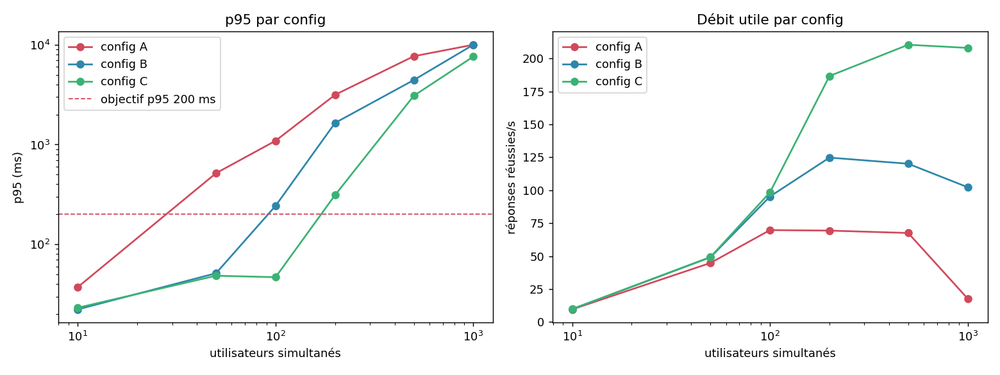
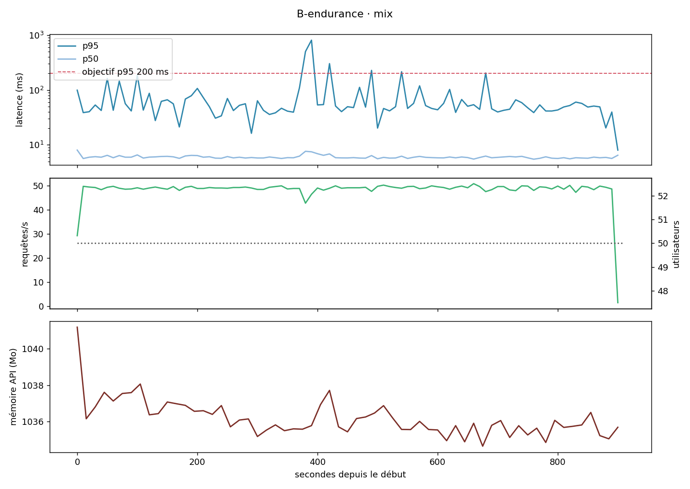

# Synthèse OPS

Ce document rassemble les décisions d'exploitation du projet et leurs preuves. La partie **dimensionnement** vient
de la campagne de charge du 17/11/2026 (phase 10) ; les autres parties (décisions techniques, preuves d'intégration,
limites connues) seront complétées en phase 12.

## Dimensionnement de l'API de prédiction

### En une phrase

Sur notre Mac (M5, 16 Go, 10 CPU et 7,7 Go pour Docker), **la configuration B (1 CPU, 2 workers) tient
50 utilisateurs simultanés, soit 49 req/s, avec un p95 de 51 ms** ; deux réplicas de B derrière nginx (C) en tiennent
**100 (98 req/s, p95 de 47 ms)**. Recommandation : **C par défaut, un réplica de B de plus par tranche de 50
utilisateurs, plafond de 4 réplicas sur cette machine.**

### Protocole

Locust, campagne automatisée (`make load-full`, [CHARGE.md](CHARGE.md)) : rampe par paliers de 2 min (10 → 50 →
100 → 200 → 500 → 1 000 utilisateurs), un utilisateur envoyant environ une requête par seconde en usage mixte (60 %
de prédictions, recherches et fiches joueur, face-à-face, un batch de 50 matchs de temps en temps). Un palier est
**tenu** si le p95 des requêtes unitaires reste sous **200 ms**, celui des batchs sous **1 s**, et les erreurs sous
**1 %**. Percentiles exacts sur chaque requête, montée du palier exclue ; CPU et mémoire des conteneurs lus dans
Prometheus.

| | |
|---|---|
| Machine | MacBook Pro (Mac17,2), Apple M5, 10 cœurs, 16 Go |
| Docker | Docker Desktop, moteur 29.9.2, 10 CPU et 7,7 Go alloués |
| Résultats | [`loadtest/results/20261117-1242-full/`](../loadtest/results/20261117-1242-full/report.md) |

### Comparaison des configurations (rampe, usage mixte)

| Config | Ressources de l'API | **Max utilisateurs tenus** | Débit à ce palier | p95 | Premier palier qui lâche | CPU API au max | Mémoire API | Saturation |
|---|---|---|---|---|---|---|---|---|
| **A** | 1 réplica · 0,5 CPU · 512 Mo · 1 worker | **10** | 10 req/s | 37 ms | 50 (p95 516 ms) | 0,14 cœur | 406 Mo | ~70 req/s ; tuée à 1 000 utilisateurs |
| **B** | 1 réplica · 1 CPU · 1,5 Go · 2 workers | **50** | 49 req/s | 51 ms | 100 (p95 243 ms) | 0,39 cœur | 851 Mo | ~125 req/s (CPU à 1,0) |
| **C** | 2 × B derrière nginx | **100** | 98 req/s | 47 ms | 200 (p95 312 ms) | 0,66 cœur | 1,7 Go | ~210 req/s réussies (CPU à 2,0) |

Ce qu'on en lit :

- **Le CPU de l'API est le goulot.** À saturation, l'API utilise toute sa limite (1,0 cœur pour B, 2,0 pour C),
  pendant que PostgreSQL reste sous 0,07 cœur. Pour B, aucune erreur jusqu'à 500 utilisateurs : les requêtes
  attendent leur tour et le p95 explose (1,6 s à 200 utilisateurs, 4,4 s à 500). En C, nginx commence à
  répondre 502 à partir de 500 utilisateurs (2,9 %).
- **Ajouter un réplica double la capacité** : 50 → 100 utilisateurs tenus de B à C, saturation de 125 à ~210 req/s
  réussies (×1,7 : nginx et la base partagée prennent le reste). La montée en charge est horizontale.
- **A est à proscrire** : 0,5 CPU ne tient que 10 utilisateurs, et 512 Mo ne suffisent pas. Un worker prend déjà
  406 Mo sous faible charge (le modèle et l'historique rejoué) ; sous 1 000 utilisateurs, l'API atteint 536 Mo pour une
  limite de 512 Mio et tombe (connexions refusées, puis 503 pendant le rechargement : 94 % d'erreurs).
- **Mémoire : ~420 Mo par worker**, qui grossit peu sous charge (+125 Mo pour B entre 10 et 500 utilisateurs,
  requêtes en attente comprises).

### Prédiction seule et batch (config B)

| Scénario | Max tenu | Débit | p95 | Coût CPU |
|---|---|---|---|---|
| `POST /predict` seul | 100 utilisateurs | 98 req/s | 43 ms | ~5 ms de CPU par prédiction (0,50 cœur à 98 req/s) |
| `POST /predict/batch` de 50 | 10 utilisateurs | 7,9 batchs/s = **~390 prédictions/s** | 658 ms | ~2 ms de CPU par prédiction (0,79 cœur) |

Un batch de 50 coûte environ **2,5 fois moins de CPU par match** qu'autant d'appels unitaires : c'est pour cela que
le scoring des matchs à venir passe par `/predict/batch`. L'usage mixte tient deux fois moins d'utilisateurs que la
prédiction seule (50 contre 100) parce que ses batchs occasionnels pèsent lourd : 1 requête sur 20 vaut 50
prédictions.

### Pic soudain (config B)

50 utilisateurs, puis **250 en 10 s** pendant 90 s, puis retour à 50 :

- p95 de 80 ms avant, **2 030 ms pendant le pic**, **aucune erreur** : l'API ralentit mais ne refuse rien ;
- retour sous l'objectif (p95 < 200 ms) **60 s** après la fin du pic, le temps de vider les requêtes en attente.

### Endurance (config B)

50 utilisateurs pendant 15 min : p95 de **59 ms**, **0 erreur**, 41 133 requêtes. Mémoire de l'API **1 037 →
1 036 Mo** (pente de −1,1 Mo / 10 min) : **pas de fuite mémoire**. Une première endurance à 100 utilisateurs, au-delà
de ce que B tient, donnait la même conclusion pour la mémoire (+3 Mo en 15 min) avec un p95 de 697 ms.

### Recommandation

| Besoin | Configuration | Ressources de l'API |
|---|---|---|
| Démo, correcteur, développement | B (1 réplica) : 50 utilisateurs, 49 req/s | 1 CPU, 1,5 Go |
| **Par défaut** | **C (2 réplicas de B + nginx)** : 100 utilisateurs, 98 req/s, et un réplica qui survit si l'autre tombe | 2 CPU + 0,5 pour nginx, 3 Go |
| Au-delà | **+1 réplica de B par tranche de 50 utilisateurs** | +1 CPU, +1,5 Go chacun |
| Plafond sur cette machine | **4 réplicas (~200 utilisateurs, extrapolé)** | 4 CPU et 6 Go : le reste de la stack (PostgreSQL, MLflow, Prefect, Grafana…) et Locust doivent garder leur part des 10 CPU et 7,7 Go de la VM |

Les 4 réplicas sont une extrapolation de la progression B → C (×2 utilisateurs, ×1,7 en débit saturé), pas une
mesure. Au-delà, il faut une autre machine. Pour un traitement de masse (scorer un tableau entier), utiliser
`/predict/batch` plutôt que des appels unitaires.

### Biais et limites de la mesure

- **Locust tourne sur la même machine** : il a pris au plus 0,25 cœur sur 10 (A à 1 000 utilisateurs), moins de
  0,05 aux paliers tenus. Le biais est faible, et les capacités mesurées sont un minimum.
- Les limites `cpus` de Docker Desktop sont des parts de la VM (10 CPU virtuels sur les cœurs du M5), pas des cœurs
  dédiés.
- La stack entière tourne pendant les mesures (PostgreSQL reçoit la trace de chaque prédiction, Prometheus collecte),
  simulation en pause : c'est l'API telle qu'elle est servie.
- Une première rampe B a été interrompue par une mise en veille du Mac (29 s sans requête, puis Locust figé). La
  campagne empêche désormais la veille (`caffeinate`), détecte un scénario interrompu et le rejoue seul dans le même
  dossier.
