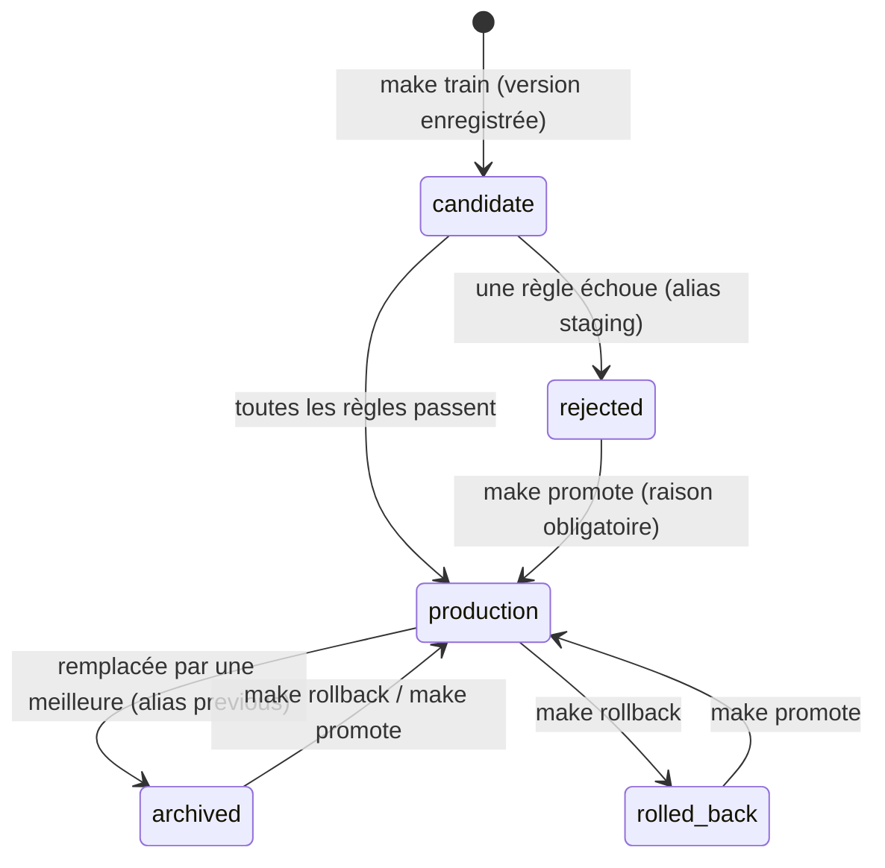

# Registre, stratégie de tagging et mise en service

Chaque `make train` enregistre une **version** du modèle `atp-winner` dans le registre MLflow. Une version n'est
servie que si l'alias **`production`** la désigne, et cet alias ne bouge que si la **règle de mise en service**
(`configs/promotion.yaml`) l'autorise, ou si une personne le décide en donnant une raison (`make promote`,
`make rollback`). Chaque décision est tracée trois fois : dans les tags de la version, dans le run de la campagne
(`rapport_campagne.html`, section « Décision de mise en service ») et dans le journal `atp-winner-decisions`.

Code : `src/tennis_mlops/registry/` (`tagging.py`, `gate.py`, `promotion.py`, `rollback.py`, `journal.py`,
`loader.py`).

## Les alias : ce qui bouge

Un alias désigne **une seule** version à la fois ; le déplacer ne touche ni au code ni aux fichiers.

| Alias | Qui le pose | Qui le lit | Pourquoi |
|---|---|---|---|
| `production` | la campagne, si toutes les règles passent ; `make promote` ; `make rollback` | l'API (`models:/atp-winner@production`, phase 7) | Le code de l'API ne contient aucun numéro de version : promouvoir ou revenir en arrière = déplacer l'alias, **sans redéploiement**. |
| `previous` | la promotion, sur la version qu'elle remplace | `make rollback` | Revenir en arrière en une commande, sans chercher dans l'historique. Après un rollback, il recule d'un cran (la version que la version restaurée avait remplacée) : un deuxième rollback reste possible. |
| `staging` | la campagne, sur un candidat **refusé** | le scoring « shadow » (phases 6-7) | Garder en observation le dernier refusé : s'il se montre meilleur sur les matchs réels, une personne peut le promouvoir (`make promote`). Retiré dès qu'une version au moins aussi récente passe en production. |

**Pourquoi des alias et pas les *stages* MLflow** (`Staging` / `Production`) : les stages sont dépréciés depuis
MLflow 2.9. Les alias les remplacent, en plus souple : noms libres, plusieurs alias possibles, et lecture directe
par URI (`models:/atp-winner@production`).

## Le cycle de vie d'une version (tag `lifecycle`)



| Valeur | Sens |
|---|---|
| `candidate` | Enregistrée, décision pas encore prise (ou campagne interrompue avant la décision). Les versions de la phase 4 sont restées dans cet état. |
| `production` | Servie aujourd'hui. |
| `archived` | A été servie, remplacée par une version au moins aussi bonne ; toujours disponible pour un rollback. |
| `rejected` | Refusée par la règle de mise en service ; `gate_reason` dit pourquoi. |
| `rolled_back` | Retirée de la production par un rollback ; `rollback_reason` dit pourquoi. |

## Les tags d'une version

Posés à l'enregistrement (provenance, qualité) puis à chaque décision (décision, cycle de vie). Liste exacte :
`TAG_GROUPS` dans `registry/tagging.py`.

| Groupe | Tags | Question à laquelle ils répondent |
|---|---|---|
| Provenance | `git_sha`, `git_dirty`, `uv_lock_sha256`, `dataset_version`, `data_window_start`, `data_window_end`, `simulated_now`, `features_version`, `config_hash`, `campaign_run_id`, `prefect_flow_run_id`, `prefect_flow_run_url`, `last_valid_lot` | Avec quoi ce modèle a-t-il été produit, et comment le reproduire ? |
| Qualité | `data_validation=passed`, `gx_suite_version`, `lots_valid`, `lots_quarantined`, `n_train`, `n_validation`, `n_test`, `test_window`, `candidate`, `selection_metric`, `validation.log_loss`, `test.log_loss` | Les données étaient-elles saines et suffisantes, et que vaut le modèle ? |
| Décision | `gate_status=passed\|failed`, `gate_reason`, `compared_to_version`, `delta_log_loss`, `decided_by=pipeline\|manual`, `decided_at` | Pourquoi est-il (ou n'est-il pas) en production ? |
| Cycle de vie | `lifecycle`, `promoted_at`, `replaced_version`, `archived_at`, `replaced_by`, `promotion_reason`, `rollback_reason`, `rolled_back_at`, `rolled_back_to`, `restored_at`, `restored_from` | Où en est-il aujourd'hui, et que s'est-il passé ? |

`config_hash` est l'empreinte de la configuration résolue : deux versions au même hash ont été produites avec les
mêmes réglages. `simulated_now` est l'horloge simulée de la dernière ingestion (le « présent » vu par le modèle).

**Tags de run** (MLflow) : `kind=campaign|candidate|decision`, `prefect.flow_run_id`, `prefect.flow_run_url`,
`git.commit`, `uv_lock.sha256`, `features_version` ; sur la campagne, `gate.status`, `gate.reason`,
`registry.version`, `registry.production_version`.

**Tags Git** : `v0.N.0` à la fin de chaque phase, `v1.0.0` au rendu. Le `git_sha` posé sur chaque version de modèle
relie les deux.

## La règle de mise en service

Le candidat retenu et la version en production sont jugés sur le **même jeu de test** : les 6 mois les plus récents
de la campagne, qu'aucun des deux n'a vus à l'entraînement. `production` n'est déplacé que si **toutes** les règles
passent ; sinon la version est `rejected` et `production` ne bouge pas. Un rejet n'est pas un échec du flow : c'est
une décision, le flow se termine en `Completed`.

| Règle | Seuil (`configs/promotion.yaml`) | Pourquoi |
|---|---|---|
| Données validées par Great Expectations | uniquement des lots acceptés par la suite bloquante | La base ne contient que des lots acceptés (phase 3) ; la règle le constate et l'écrit sur la version. |
| Jeu de test assez grand | `min_test_rows: 500` | En dessous, l'écart entre deux modèles est du bruit. |
| Meilleur que l'Elo pur (log loss) | ≤ baseline Elo | Un modèle qui ne bat pas une formule sans apprentissage n'a rien à faire en production. |
| Accuracy au moins celle du « mieux classé gagne » | ≥ baseline classement | Le minimum attendu par un utilisateur. |
| Au moins aussi bon que la production (log loss) | ≤ production − `min_improvement` (0) | Avec ε = 0, à égalité le plus récent l'emporte : il a vu des données plus fraîches. Monter ε pour exiger un gain net. |
| Pas de régression par surface | ≤ +`max_segment_regression` (0,03), surfaces d'au moins `min_segment_rows` (100) matchs de test | Une moyenne meilleure peut cacher une surface dégradée (gazon, peu de matchs). |
| Pas de dérive forte des données | PSI max ≤ `max_psi` (0,25) contre la campagne précédente | Si les données ont fortement changé, une personne doit regarder avant de servir. |

La log loss est la métrique de décision (elle juge la **probabilité**, ce que l'API sert) ; l'accuracy n'est qu'un
garde-fou. `make train-weak` le montre : un modèle trop régularisé classe bien les favoris (accuracy correcte) mais
annonce des probabilités écrasées vers 50 % (log loss mauvaise) : il est refusé.

Cas particuliers :

- **Pas encore de production** (première campagne) : les règles « production » et « surface » sont *sans objet* ;
  le candidat est promu s'il bat les baselines.
- **Production incomparable** (autre `features_version`) : traitée comme absente, le candidat est jugé sur les
  baselines. Un changement de features est une évolution du modèle, pas une régression.

Le verdict détaillé (règle, résultat, mesuré, seuil) est dans le run de la campagne : `decision/gate.json`,
`decision/rules.csv`, section « Décision de mise en service » de `rapport_campagne.html`, métriques `gate/passed`,
`gate/rules_failed`, `gate/delta_log_loss`.

## Promotion, rejet, rollback : ce qui est écrit, dans quel ordre

MLflow n'a pas de transaction sur les alias : l'ordre des écritures garantit que `production` désigne **toujours**
une version valide, même si la commande est coupée au milieu.

| Décision | Écritures |
|---|---|
| Promotion (campagne ou `make promote`) | `previous` ← ancienne production · `production` ← nouvelle · ancienne : `lifecycle=archived`, `replaced_by` · nouvelle : `lifecycle=production`, `replaced_version`, décision · `staging` retiré s'il est plus ancien |
| Rejet | version : `lifecycle=rejected`, décision · `staging` ← version |
| Rollback | `production` ← `previous` · version retirée : `lifecycle=rolled_back`, `rollback_reason`, `rolled_back_to` · version restaurée : `lifecycle=production`, `restored_from` · `previous` recule d'un cran ou disparaît |

Une promotion manuelle garde le `gate_status` d'origine (par exemple `failed`) et ajoute `decided_by=manual` et
`promotion_reason` : on voit qu'une personne a passé outre la règle, et pourquoi.

**Le rollback ne dépend que de MLflow** (ni Prefect, ni l'entraînement, ni la base du projet) : c'est la commande des
incidents, elle doit marcher quand le reste est en panne. Une fois appliqué, il est **annoncé** (phase 6) : une ligne
dans `pipeline_events` et une carte Teams via le service d'alertes ([`ALERTES.md`](ALERTES.md)). Si la base ou le
service ne répondent pas, la commande le dit en une ligne et réussit quand même.

**Sans redéploiement** : `registry/loader.py` (`AliasModelLoader`) relit l'alias et ne recharge le modèle que si le
numéro de version a changé ; si MLflow ne répond plus, le dernier modèle chargé reste servi. L'API de la phase 7
l'appellera périodiquement. Un test le démontre déjà : promotion puis rollback, servis par le même objet, dans le
même processus.

## Le journal des décisions

L'expérience MLflow **`atp-winner-decisions`** contient un run par décision : `promotion v9`, `rejet v10`,
`promotion manuelle v11`, `rollback v11 → v9`. Tags `event`, `version`, `production_before`, `production_after`,
`decided_by`, `reason`, `decided_at`, `campaign_run_id` ; artefacts `decision/event.json` et `decision/rules.csv`.
Le registre donne l'**état** ; le journal donne l'**historique**, dans l'ordre. Chaque décision est aussi inscrite
dans la table `pipeline_events` de la base du projet ([`ORCHESTRATION.md`](ORCHESTRATION.md)), d'où les annotations
Grafana la reprennent ([`MONITORING.md`](MONITORING.md)).

## La chaîne de traçabilité

```
prédiction (phase 7 : model_version + request_id)
  → version du modèle (tags ci-dessus)
    → run MLflow du candidat (paramètres, métriques, graphiques, modèle, git_sha, uv.lock)
      → run de la campagne (config résolue, données, dérive, décision)
        → run Prefect (logs, durées, retries)
          → lots de données acceptés par Great Expectations (lot_id, dernier lot, horloge simulée)
            → source (dataset_version, révisions et SHA-256 de configs/data.lock.json)
```

`make trace` (ou `make trace VERSION=11`) affiche cette chaîne avec les liens :

```
atp-winner v9 — alias : production · lifecycle : production

0. prédiction  (phase 7) chaque ligne `predictions` portera model_version + request_id → cette version
1. version     décision passed (pipeline, 2026-11-10T10:34:26+00:00) — toutes les règles passent (…)
2. run MLflow  http://127.0.0.1:7282/#/experiments/1/runs/…
                candidat logreg C=0.05 · test log loss 0.60017 · config 0ef26129a0e5c4dc · features v1
                git 37aa252… (modifications non commitées : False) · uv.lock 148665b64a93
3. campagne    http://127.0.0.1:7282/#/experiments/1/runs/…
4. run Prefect http://127.0.0.1:4201/runs/flow-run/…
5. données     282 lots acceptés par la suite GX v1.0 (0 en quarantaine exclus) · dernier lot 2016-M-DC-…
                fenêtre 2011-01-01 → 2016-11-27 · test 2016-05-28 → 2016-11-27 · horloge simulée 2016-12-31
6. source      dataset_version 73331ef02f46 (conforme au verrou) · révisions : … · SHA-256 dans data.lock.json
```

## Commandes

| Commande | Effet |
|---|---|
| `make train` | Campagne + décision : la version est promue ou refusée selon la règle |
| `make train-weak` | Campagne volontairement mauvaise (`configs/train-weak.yaml`) : enregistrée puis **refusée** |
| `make registry` | Versions, alias, cycle de vie et décision de chacune |
| `make promote VERSION=12 REASON="…"` | Mise en production manuelle (la raison est obligatoire et tracée) |
| `make rollback REASON="…"` | `production` ← `previous` |
| `make trace [VERSION=…]` | Chaîne de traçabilité (défaut : la version en production) |

Démonstration complète (scénarios S6 et S7) :

```bash
make train            # v9 : première mise en production
make train-weak       # v10 : refusée, production inchangée (v9), staging = v10
make train            # v11 : comparée à v9 sur le même test, promue ; previous = v9
make rollback REASON="probabilités aberrantes"   # production = v9, v11 rolled_back
make registry         # l'état ; le journal est dans l'expérience atp-winner-decisions
```
