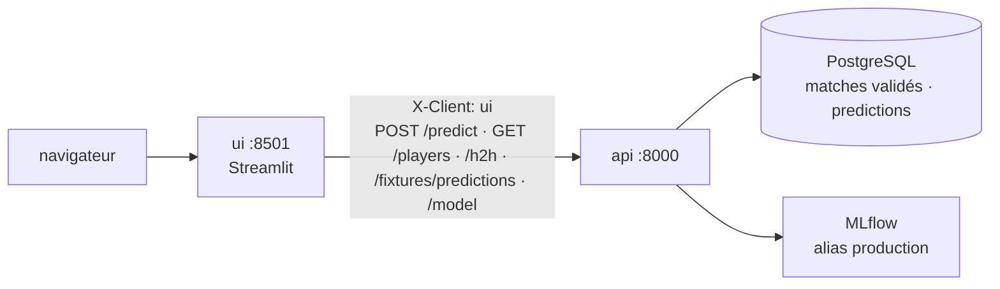

# Interface web de test

Une interface Streamlit pour essayer le modèle sans ouvrir de terminal : choisir deux joueurs et une surface, obtenir
la probabilité de chacun, la version qui l'a calculée et ce que le modèle a vu ; explorer un joueur, un face-à-face,
et les matchs que le scoring a prédits à l'avance.

Service `ui` de la stack, sur **http://127.0.0.1:8501** (`make up`, puis `make ui-open`). Code :
`src/tennis_mlops/ui/` (`app.py`, `pages/`, `components.py`, `views.py`).



**Elle ne parle qu'à l'API.** Aucune connexion à la base ni à MLflow, aucun identifiant : le service ne reçoit même
pas le fichier `.env` (`env_file: []` dans `compose.yml`), seulement l'adresse de l'API et les liens vers les autres
interfaces. Chaque appel se présente avec `X-Client: ui` : ses prédictions sont tracées dans `predictions`,
comptées dans Prometheus et jugées par le feedback exactement comme celles du scoring.

## Les pages

| Page | Ce qu'on y fait | Endpoints |
|---|---|---|
| **Match** | deux joueurs (recherche par nom, sans accents, ou par identifiant), surface, niveau, tour, format → probabilité de chacun, version, latence (dans l'API et aller-retour), `request_id`, et les features clés côte à côte : classement, Elo général et sur la surface, forme, face-à-face, âge, avec l'écart que voit le modèle | `POST /predict`, `GET /players`, `/players/{id}/stats`, `/h2h` |
| **Joueur** | classement au début de chaque tournoi, bilans (général, 52 semaines, par surface, par niveau), forme sur les 10 derniers matchs, Elo par surface, derniers résultats ; à une date passée si on veut | `GET /players/{id}/stats?as_of=` |
| **Face-à-face** | bilan des rencontres, par surface, et la liste des matchs | `GET /h2h` |
| **Matchs à venir** | les matchs que `scoring-atp` a prédits à l'avance ; une fois leur tournoi ingéré : le vainqueur, le score et si le modèle avait raison | `GET /fixtures/predictions` |
| **Modèle** | version en production, candidat, log loss de test, date de mise en service, qualité en ligne, horloge simulée, liens vers MLflow, Prefect, Grafana et la documentation de l'API | `GET /model`, `/ready` |

La barre latérale garde l'état de l'API sous les yeux : prête, dégradée ou pas prête, version servie, dernière
journée de l'historique.

## Aucune fuite du futur

Les quatre endpoints de consultation (phase 8) lisent le même instantané que les prédictions : les matchs
**validés** en base, rejoués au même moment. Ce que l'ingestion n'a pas encore accepté n'existe pas pour
l'interface, et l'ingestion ne reçoit que des tournois terminés à l'horloge simulée.

- `as_of` ne peut que reculer : une date postérieure à la dernière journée de l'historique est ramenée à celle-ci ;
- à une date passée, les bilans, la forme, le classement et l'âge sont ceux de ce jour-là ; l'Elo n'est affiché qu'à
  la dernière journée (c'est l'état exact que verrait le modèle pour un match du lendemain : il n'est pas historisé) ;
- les forfaits ne comptent ni dans les bilans ni dans le face-à-face, comme pour les features ;
- dans **Matchs à venir**, un match dont la date est passée mais dont le tournoi n'est pas encore validé est
  « résultat en attente », jamais deviné.

Le face-à-face affiché est celui que reçoit le modèle (`h2h_diff`) : un test le vérifie sur toutes les paires.

## Les erreurs, dites simplement

| Situation | Ce que montre l'interface |
|---|---|
| API arrêtée | « API injoignable » + `make up` |
| Aucune version en production | « Le service ne peut pas répondre » + `make train` ; les pages Joueur et Face-à-face marchent quand même |
| Aucun match en base | même message + `make ingest` ou `make demo` |
| Modèle entraîné avec d'autres features | même message + `make train` |
| Nom introuvable | « Aucun joueur ne correspond » ; le bouton Prédire reste désactivé |
| Débutant (identifiant sans aucun match) | accepté : l'API le prédit avec l'Elo de départ et le dit (avertissement affiché) |
| Deux fois le même joueur | refusé avant l'appel |
| Requête refusée (`422`) | le message de l'API, tel quel |

## Endpoints ajoutés à l'API

| Endpoint | Réponse |
|---|---|
| `GET /players?search=&limit=` | joueurs dont le nom contient tous les mots (accents et casse ignorés) ou l'identifiant exact ; sans texte, les joueurs classés ayant joué dans l'année, par classement |
| `GET /players/{id}/stats?as_of=` | profil à la date, Elo et forme (dernière journée), bilans, forme, classement dans le temps, 15 derniers matchs ; `404 unknown_player` sans aucun match |
| `GET /h2h?p1=&p2=` | total, victoires de chacun, par surface, rencontres de la plus récente à la plus ancienne |
| `GET /fixtures/predictions?days=&client=` | dernière prédiction de chaque match daté depuis `days` jours avant l'horloge, par défaut celles du scoring (`client=` vide : tous), avec son statut : `upcoming`, `awaiting_result`, `played` (vainqueur, score, juste ou non), `walkover` |

Elles ne demandent pas de modèle : sans version en production, on explore encore les joueurs. Le nom du tournoi
d'une prédiction est désormais gardé (`tourney_name`, envoyé par le scoring) ; la colonne est ajoutée à la table
`predictions` d'une base existante au démarrage de l'API, sans perte.

## Tests

- `tests/unit/ui/test_pages.py` : chaque page est exécutée par `AppTest` de Streamlit contre l'API en mémoire
  (vraie application FastAPI, vrai service, base SQLite) : prédiction, recherche, débutant, même joueur, API
  injoignable, aucun modèle. Le scénario **S9** y est vérifié : une prédiction faite depuis la page Match est dans
  `predictions` avec `client = 'ui'`.
- `tests/unit/ui/test_views.py` : messages d'erreur, libellés, tableaux, ligne de commande.
- `tests/unit/serving/test_history.py`, `tests/unit/api/test_consultation.py` : statistiques exactes, `as_of` borné,
  face-à-face identique à la feature, statuts des matchs à venir, mise à niveau de la table.
- `make ui-smoke` : sur la stack qui tourne, le service répond, la page Match prédit contre la vraie API, et la
  ligne `predictions` est retrouvée par le `request_id` affiché. `make scenarios` (phase 11) le reprendra.

```sh
make up          # la stack, interface comprise
make ui-open     # http://127.0.0.1:8501
make ui-smoke    # ✅ interface en ligne · ✅ prédiction affichée · ✅ tracée dans predictions (client ui)
make ui          # hors Docker, contre l'API de TENNIS_API_URL
```
