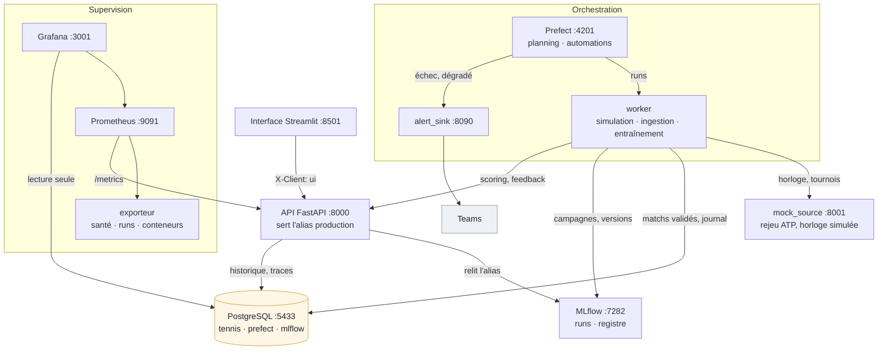
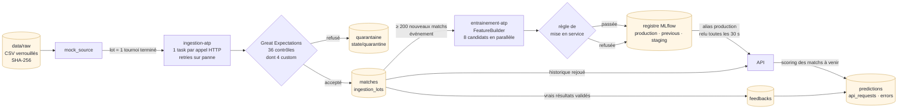
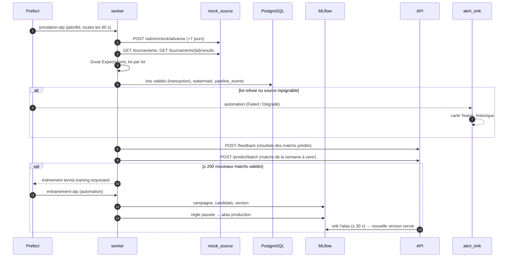

# Architecture

Une chaîne MLOps complète, locale, dans Docker : des matchs ATP rejoués dans le temps par une source simulée sont
ingérés et contrôlés, servent à entraîner et mettre en service un modèle, que l'API utilise pour prédire les matchs à
venir ; les vrais résultats reviennent juger ces prédictions. Prefect orchestre, MLflow trace et versionne,
PostgreSQL garde tout, Prometheus et Grafana surveillent.

Chaque brique a sa documentation détaillée ; ce document montre comment elles s'emboîtent.

## Les services

| Service | Image | Rôle | Doc |
|---|---|---|---|
| `mock_source` | projet | API de rejeu : horloge simulée, aucune donnée du futur, incidents à la demande (`503`, `slow`, `corrupt`, `schema`) | [MOCK_SOURCE.md](MOCK_SOURCE.md) |
| `postgres` | `postgres:18.6` | une base par usage (`tennis`, `prefect`, `mlflow`) : Prefect et MLflow y gardent aussi leurs métadonnées ; un compte par usage | — |
| `prefect` | projet | serveur Prefect 3.8.7 (UI, planning, automations) | [ORCHESTRATION.md](ORCHESTRATION.md) |
| `orchestration-setup` | projet | ponctuel : work pool, déploiements, automations (idempotent, à chaque `up`) | [ORCHESTRATION.md](ORCHESTRATION.md) |
| `worker` | projet | exécute les runs : simulation, ingestion, entraînement | [ORCHESTRATION.md](ORCHESTRATION.md) |
| `mlflow` | projet | suivi des campagnes, artefacts, registre `atp-winner` et ses alias | [ENTRAINEMENT.md](ENTRAINEMENT.md), [TAGGING.md](TAGGING.md) |
| `alert_sink` | projet | reçoit les automations et les décisions du registre, construit la carte Teams, garde l'historique | [ALERTES.md](ALERTES.md) |
| `api` | projet | prédictions servies par la version `production`, traces, feedback, métriques | [API.md](API.md) |
| `ui` | projet | interface de test : ne parle qu'à l'API | [UI.md](UI.md) |
| `exporter` | projet | ce que l'API ne mesure pas : sonde la santé de chaque service, l'horloge simulée, les runs Prefect, le CPU et la mémoire de chaque conteneur (API Docker) | [MONITORING.md](MONITORING.md) |
| `prometheus`, `grafana` | officielles | métriques ; dashboards technique, métier, croisé, provisionnés depuis Git | [MONITORING.md](MONITORING.md) |

**Une seule image** (`Dockerfile`) pour tout le code du projet, construite depuis `uv.lock` : mêmes versions partout,
du serveur Prefect au worker. Elle tourne sous un utilisateur non-root ; seul l'exporteur est root (lecture du socket
Docker).

## Le flux des données

1. **Source.** `make data` télécharge les CSV de Jeff Sackmann à une révision figée et vérifie chaque fichier
   contre `configs/data.lock.json` ; `mock_source` les rejoue selon son horloge, sans jamais rien révéler du futur
   ([DONNEES.md](DONNEES.md)).
2. **Ingestion.** Un lot = un tournoi terminé. Great Expectations le contrôle : refusé, il part en quarantaine et le
   flow échoue (alerte) ; accepté, il est stocké en une transaction. Source injoignable : état « Dégradé », rien n'est
   perdu ([INGESTION.md](INGESTION.md)).
3. **Entraînement.** Au-delà de 200 nouveaux matchs validés, l'ingestion émet `tennis.training.requested` ; une
   automation lance la campagne : le même `FeatureBuilder` que l'API calcule 19 features avant chaque match (Elo par
   surface, forme, face-à-face…), 8 candidats s'entraînent en parallèle, le meilleur sur la validation est jugé sur
   un test jamais vu ([ENTRAINEMENT.md](ENTRAINEMENT.md)).
4. **Mise en service.** La version est enregistrée ; la règle la compare à la production et aux baselines sur le même
   test. Passée : l'alias `production` bouge (`previous` garde l'ancienne). Refusée : `staging`, rien d'autre ne
   change ([TAGGING.md](TAGGING.md)).
5. **Service.** L'API relit l'alias toutes les 30 s : une promotion ou un rollback est servi sans redémarrage. Elle
   rejoue l'historique validé pour calculer les features, trace chaque requête ([API.md](API.md)).
6. **Boucle fermée.** À chaque pas, le scoring prédit les matchs de la semaine à venir ; au pas suivant, le feedback
   remonte leurs vrais résultats (validés par l'ingestion) : accuracy, log loss et Brier en ligne, par version.

## Un pas de la chaîne, dans le temps

Ce que fait chaque minute `make demo` (un pas = une semaine simulée) :

## Ce qui est produit, et où le retrouver

| Artefact | Où | Comment le voir |
|---|---|---|
| Données brutes et leur verrou | `data/raw/` (hors Git), `configs/data.lock.json` | `make data-verify` |
| Lots acceptés, refusés (JSON brut + rapport de validation) | `state/lots/`, `state/quarantine/` | `make lots`, Prefect |
| Rapports Great Expectations | `state/gx/…/data_docs/` | `make gx-docs` |
| Matchs validés, lots, watermark | base `tennis` : `matches`, `ingestion_lots`, `ingestion_state` | `make db` |
| Journal du pipeline (lots, demandes d'entraînement, décisions, alertes) | `pipeline_events` | annotations Grafana, `make alerts` |
| Runs des flows, retries, durées | base `prefect` | UI Prefect |
| Campagnes, candidats, métriques, graphiques, rapports HTML, modèles (skops), fiche modèle | base `mlflow` + volume `mlflow_artifacts` | UI MLflow |
| Versions, alias, tags de décision | registre MLflow `atp-winner`, expérience `atp-winner-decisions` | `make registry`, `make trace` |
| Requêtes, prédictions, erreurs, feedbacks | `api_requests`, `predictions`, `errors`, `feedbacks`, vues `prediction_outcomes`, `online_metrics` | `make predictions`, Grafana |
| Métriques de l'API et de la chaîne | volume `prometheus_data` (15 jours) | Prometheus, Grafana |
| Tests d'acceptation | `state/acceptance/rapport.html` et `.json` | `uv run tennis report` |
| Résultats des tests de charge | `loadtest/results/<campagne>/` (dans Git, sauf le journal brut) | [CHARGE.md](CHARGE.md) |

**Traçabilité.** Toute prédiction remonte à sa source : `predictions.model_version` → version du registre (tags de
provenance) → run MLflow du candidat (paramètres, `git_sha`, empreinte de `uv.lock`) → campagne → run Prefect →
lots acceptés par Great Expectations → `dataset_version` et SHA-256 des fichiers. `make trace` affiche la chaîne.

## Configuration, secrets, réseau

- **Deux sortes de réglages.** `configs/*.yaml` décrit l'expérience (rejeu, contrôles, grille, règle de mise en
  service) : versionné, tracé dans MLflow, clés inconnues refusées. `.env` décrit l'environnement (adresses, mots de
  passe de démo, webhook Teams) : jamais commité, créé depuis `.env.example` au premier `up`.
- **Le seul secret** est l'URL du webhook Teams : facultative, lue dans `.env`, jamais écrite (ni logs, ni tags, ni
  messages d'erreur).
- **Moindre privilège.** Un compte PostgreSQL par usage : `tennis` (ingestion, entraînement), `app_writer` (l'API :
  écrit ses traces, ne fait que lire les matchs), `grafana_reader` (lecture seule), `prefect`, `mlflow`. L'interface
  ne reçoit ni `.env` ni identifiants.
- **Rien n'est exposé** : tous les ports sont publiés sur `127.0.0.1`, décalés (5433, 4201, 7282…) pour coexister avec
  la stack des TP.
- **Ressources bornées** : chaque service a une limite mémoire (`compose.yml`) ; le dimensionnement de l'API est
  mesuré dans [SYNTHESE_OPS.md](SYNTHESE_OPS.md).
