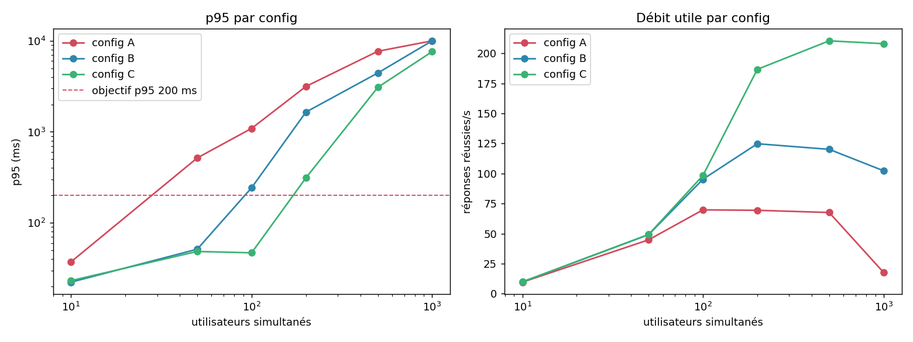
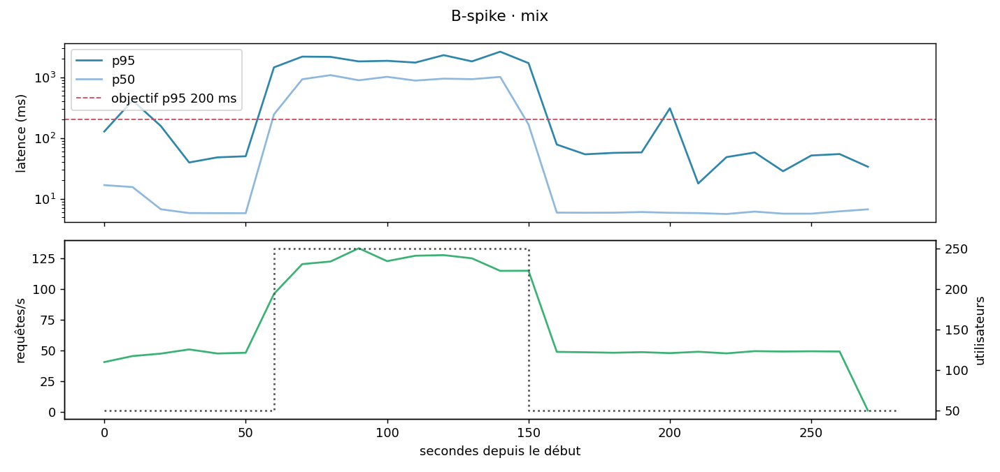
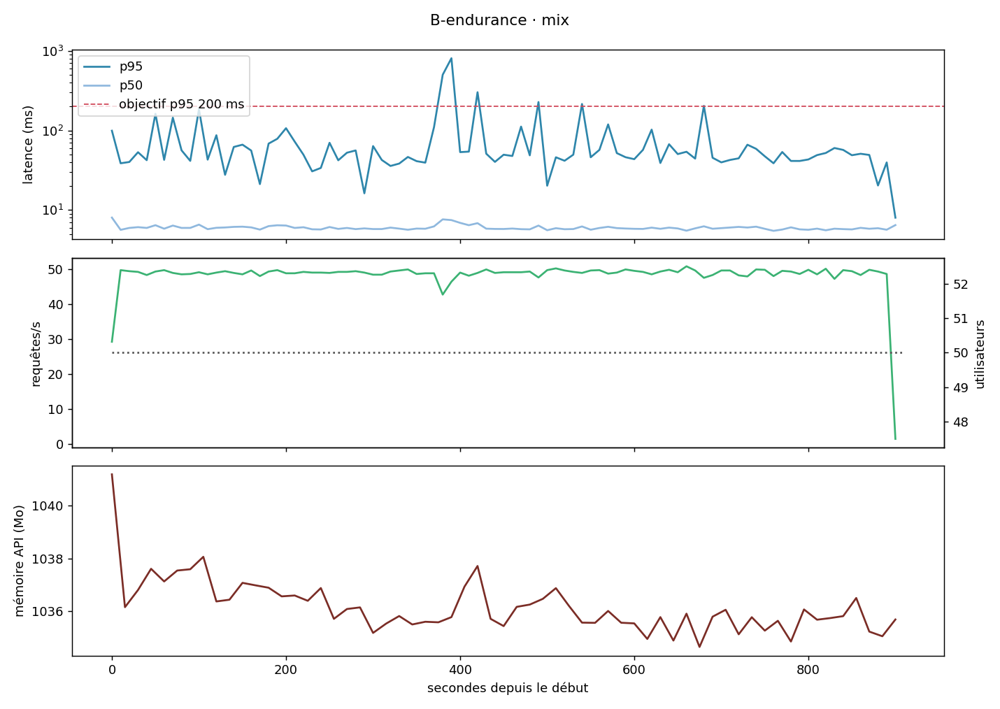

# Campagne de charge « full » (17/11/2026 14:30)

Objectif d'un palier : **p95 < 200 ms** sur les requêtes unitaires, **p95 < 1000 ms** sur les batchs de 50 matchs, et **erreurs < 1%**. Un utilisateur envoie environ une requête par seconde.

## Machine de référence

- système : Darwin 27.0.0 (arm64)
- cœurs (machine) : 10
- mémoire (machine) : 16 Go
- modèle : Mac17,2 · Apple M5
- Docker : 29.9.2 · 10 CPU · 7.7 Go alloués

## Capacité (rampes)

| Scénario | Configuration | Max utilisateurs tenus | Débit (req/s) | p95 (ms) | Premier palier qui lâche | CPU API (cœurs) | Mémoire API (Mo) | CPU Locust (cœurs) |
|---|---|---|---|---|---|---|---|---|
| ramp (mix) | A : 1 réplica · 0,5 CPU · 512 Mo · 1 worker uvicorn | **10** | 10 | 37 | 50 | 0.14 | 406 | 0.02 |
| ramp (mix) | B : 1 réplica · 1 CPU · 1,5 Go · 2 workers uvicorn | **50** | 49 | 51 | 100 | 0.39 | 851 | 0.03 |
| ramp (mix) | C : 2 réplicas de B derrière nginx (2 CPU) | **100** | 98 | 47 | 200 | 0.66 | 1 722 | 0.05 |
| ramp-predict (predict) | B : 1 réplica · 1 CPU · 1,5 Go · 2 workers uvicorn | **100** | 98 | 43 | 200 | 0.50 | 924 | 0.05 |
| ramp-batch (batch) | B : 1 réplica · 1 CPU · 1,5 Go · 2 workers uvicorn | **10** | 8 | 658 | 20 | 0.79 | 956 | 0.01 |

## Pic (B-spike)

- p95 avant : 80 ms · pendant : **2 030 ms** (erreurs 0.0%) · après : 995 ms
- retour sous l'objectif après la fin du pic : **60 s**

## Endurance (B-endurance)

- mémoire de l'API : 1 037 → 1 036 Mo, pente -1.1 Mo / 10 min : pas de fuite
- 50 utilisateurs pendant 15 min : p95 59 ms, erreurs 0.00%

## Détail par scénario

- `A-ramp/` : stages.csv, endpoints.csv, timeline.csv
- `B-ramp/` : stages.csv, endpoints.csv, timeline.csv
- `C-ramp/` : stages.csv, endpoints.csv, timeline.csv
- `B-ramp-predict/` : stages.csv, endpoints.csv, timeline.csv
- `B-ramp-batch/` : stages.csv, endpoints.csv, timeline.csv
- `B-spike/` : stages.csv, endpoints.csv, timeline.csv
- `B-endurance/` : stages.csv, endpoints.csv, timeline.csv

## Biais

Locust tourne sur la même machine que la stack : il prend du CPU à l'API (colonne CPU Locust). Les capacités mesurées sont donc un minimum ; sur deux machines, l'API en tiendrait davantage.
